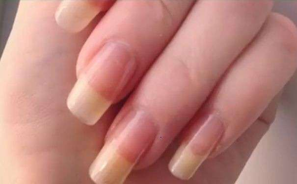
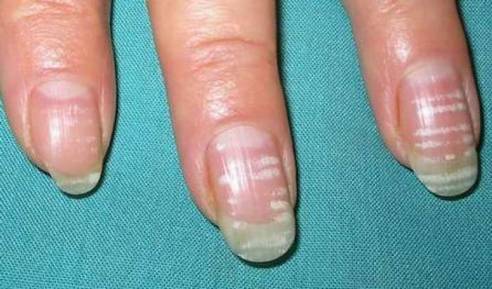
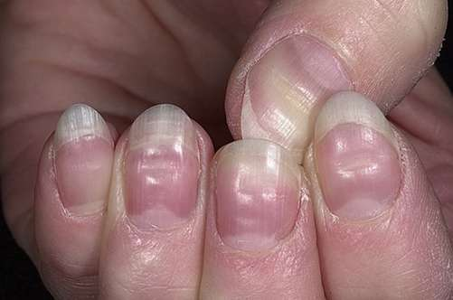
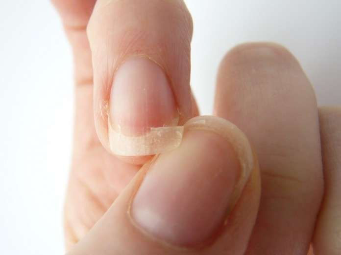
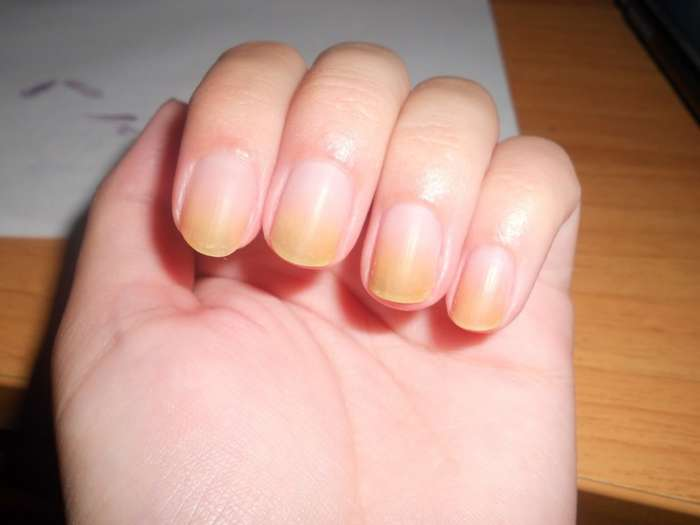
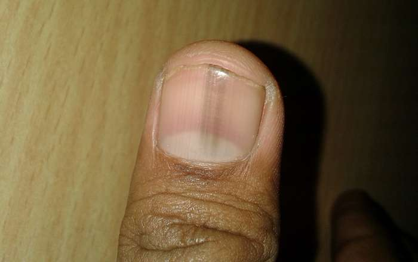

# Хумсны толиогоо анзаарч байх хэрэгтэй

Эрүүл мэндийн байдал, биеийн зарим хэсгүүд дээр илэрч, түүгээр онош тогтоох боломжтой, тиймээс хумсны толион дээр гарах өөрчилөлтүүд бие организм дах өвчлөлийг зааж болно гэж үздэг байна. Анзаараад авахад илүүдэхгүй биз ээ. Эрүүл хүний хумс, толигор ягаавтар өнгөтэй байх ёстой аж.

#### Хумсны өнгө өөрчилөгдөх

Хумс цайрах. Амин дэмийн ноцтой дутагдал\
Хумс шарлах. Байнга лак хэрэглэдгээс, тэр тусмаа лакныхаа чанарт анхаарах хэрэгтэйг харуулна\
Хумс хүрэн бор өнгөтэй болох. Бамбай булчирхайн үйл ажиллагаанд өөрчилөлт орсоныг заана\
Саарал эсвэл хөхөлбөр өнгөтэй хумс, цусан дах хүчил төрөгчийн дутагдалыг харуулах ба зүрх, уушигны асуудалтай болж буйг харуулдаг

---

#### Хумсны толио судалтах, толботой болох

Цагаан толбо тогтох. Бага зэргийн амин дэмийн дутагдал, сэтгэл санааны хямралтай үед гарч ирдэг\
Хөндлөн ховилорхуу зүйл гарах. Халуун хүйтний үйлчилэлээс болдог. Химийн эмчилгээний дараа ихээхэн ажиглагддаг\
Цайвардуу, хөндлөн судал тогтох. Уургийн дутагдалыг заах ба хоол хүнсний хэрэглээндээ анхаарах хэрэгтэй. Мөн элгээ үзүүлж шалгуулахад илүүдэхгүй\
Босоо бараан судал. Зөвхөн нэг хурууны хумсан дээр гарсан бол арьсны ракын эхний шинж байх өндөр магадлалтай

---

#### Хумсны хэлбэр өөрчилөгдөх

Хумсны хэлбэр өөрчилөгдөх дараах байдлууд ажиглагдвал эмчид даруй хандах хэрэгтэй.\
Хумсны хэмжээ томорч, нимгэрч зөөлрөх нь, элэг, зүрх, уушигны асуудалтай болж буйг харуулдаг\
Хумс дээш сөрдийж ургах. Организм дах төмрийн дутагдлыг заана\
Хумс зузаарч хатуурах. Уушиг зүрхээ үзүүлэх хэрэгтэй. Мөн псориаз, экземийн үед ийм байдал ажиглагдах ч шар өнгөтэй байдаг\
Хумс үелэж хугарамтгай болох. Бамбай булчирхайн үйл ажиллагаа өөрчилөгдөж буйг харуулна. Түүнчилэн, нас, лак хэт хэрэглэх, угаалгын бодисны нөлөө зэргээс мөн хугарамтгай болох нь бий

---

---

