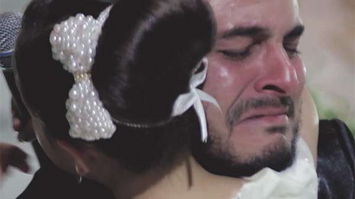
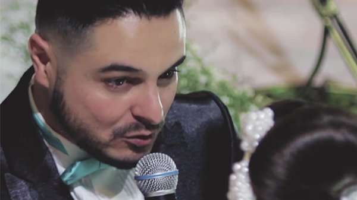
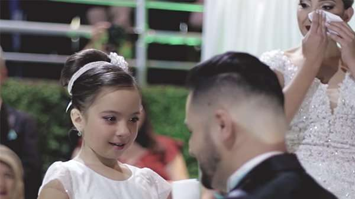

# Хуриман дээрээ, хүргэн нь, өөр хүнд хайртайгаа хэлж бүхнийг уйлуулсан уярам түүх

Хуриман дээрээ, хүргэн залуу өөр охинд хайртайгаа хэлж, бүр түүнийхээ өмнө сөхрөн хайртайгаа илэрхийлэхэд, хуримын зочид уяран уйлсан гэнэ.

---

Энэ хуримын ёслол, төлөвлөгөөний дагуу явагдаж байсан бөгөөд, дурлалт хос, сүмийн Бурханы өмнөх тавцан дээр, Бурханы өмнө хайр дурлалдаа болон бие биедээ үнэнч байх тангаргаа өргөхөөр гарцгаав. Хүмүүс, хуримын ёслолын оргил үе, хайрын тангаргийг хүлээцгээн, хүндэтгэл төгс байдалд, нам гүм болжээ. Гэтэл, дурлалт хосын хүргэн залуу нь, гэрлэлтийн хамгийн чухал энэ үед, хайрын тангаргаа өргөмөгцөө, гэнэт, хайртай бүсгүйгээс нь гадна, бас нэгэн хязгааргүй хайртай хүн байдаг гэж зарлах мэт хэлээд, олны дундах нэгэн рүү заажээ. Зочид алмайран таг чимээгүй болж, кино зохиолд гардаг, хуриман дээрээ бүсгүйгээ орхин явж, зовлонд унагадаг зүрх сэтгэлгүй залуусын тарьдаг гунигт процессыг хүлээн авахад бэлтгэн зогсоцгоотол, залуу маань, дурлалт бүсгүйнхээ охиныг тавцан дээр гарган өмнө нь сөхрөн, -“Би, чамайг ч мөн хайрлан халамжилж, хамгаалах болно, би, чамтай ямар нэг муу зүйл тохиолдохыг зөвшөөрөхгүй гэдгээ Бурханы өмнө андгайлж байна” гэжээ. Бүсгүйн охин 8 настай, эцэггүй өсч, ээж нь ч, сайн хань, охинд нь сайн аав болох хүнийг хүлээж байсан нь гарцаагүй юм. Ийм зүйл болохыг огтхон ч тааварлаагүй байсан бэр бүсгүй, баярын нулимс унаган балмагдан зогссон бөгөөд хуримын зочид, байдал ийнхүү сайхнаар эргэсэнд, мөн хүргэн залуугийн хүнлэг сайхан сэтгэлд уяран, бүгд баярын нулимс унагацгаажээ. Ийнхүү баяр дээр баяр нэмсэн, хүн чанар, сайхан сэтгэлээр хүн бүрийн сэтгэлийг хөдөлгөн догдлуулсан хурим аз жаргал, баяр дүүрэн, гайхалтай сайхан болсон нь дамжиггүй.
