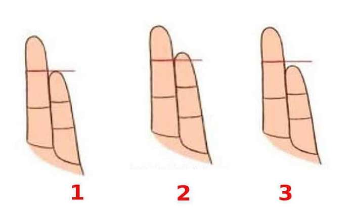

# Хуруунуудыг нь хараад л, хайр дурлалын хандлагыг нь мэд

Энэ тест, инээдтэй итгэмээргүй санагдаж магад. Гэвч, эрдэмтэд, чигчий хурууг, цусан дах тестостерон, эстрогеныг тодорхойлоход ашигладаг гэдгийг мартаж болохгүй. Бушуухан чигчийгээ хараарай!

Гарынхаа алган талаас, чигчий хуруугаа, ядам хурууны, дээд үеийн аль хэсэгт хүрч байгааг хараарай! Дээд үеэс илүү гарч байна уу? Тэнцүү байна уу? Эсвэл хүрэхгүй байна уу?

---

#### 1. Хэрэв, чигчийний өндөр, ядам хурууны дээд үетэй тэнцүү байвал:

Хамгийн сайн..! Та, эсрэг хүйсийн хүмүүстэй гайхалтай зохицдог. Та, хүмүүсийг, илбийн юм шиг татах, “соронз” л гэсэн үг. Та, харьцааны бүхий л барилуудыг гайхамшигтай эзэмшсэн, хэн нэгэн анхаарлыг тань татсан хүнтэй харилцахад л, хүссэндээ хүрэх, амжилт гарцаагүй дагадаг. Удаан бодож төлөвлөх шаардлага ч алга, инээмсэглээд л, гүйцээ...

#### 2. Хэрэв, чигчийний өндөр, ядам хурууны дээд үеэс илүү гарч байвал:

Таны, хайрт хүн тань маш азтай. Тан шиг, тэвчээртэй, үнэнч хүн үнэхээр ховор. Гэхдээ та, хүсвэл, бусдын сэтгэлийг татах онцгой авъяастай. Үүнээс болж хардалтад өртдөг боловч мөн дур хүслийг ч хүртдэг. Та өөрийнхөө сэтгэлийг сайхан илэрхийлдэг. Таны төрөлхийн, сайхан сэтгэл, амьдралд хайртай зан чинь соронз мэт бусдыг татдаг. Харьцааны эхний үед, таны зан төрхийг, итгэлгүй хүлээж авах үе байдаг. Сэтгэлээр уналгүй ,зоригтой байж, өөрийнхөө совинг анзаараарай

#### 3. Хэрэв, таны чигчийний өндөр, ядам хурууны дээд үеийн зураасанд хүрэхгүй байвал:

Та , хайр дурлалын харьцаанд, хэт хатуу шаардлагатай хүн юм. Та, үргэлж өөрийнхөөрөө байлгах дуртай. Бусдаас зөвхөн, зөв зүйлийг л шаардаж, болохгүй бол сэтгэл чинь гонсойдог. Энэ бол таны дутагдалтай тал боловч, нөгөө талаас бас ололт. Та юу хүсч байгаагаа маш тодорхой мэддэг учраас шалдир булдир зүйлээс хол явдаг.\
Та, анхны уулзалтын эхний хоромд л, “өөрийн” хүнийг таних чадвартай. Мөн толгойг нь эргүүлж ч чадна. Таны дур булаам байдал, оньсого шиг төрх бусдыг сөхрүүлдэг.

Та, үүнийг уншиж байхдаа, инээж хошигнон суугаа, гэдэгт тань итгэлтэй байна. Ямартай ч, таны хайр дурлал, аз жаргал, зөвхөн, танаас, өөрөөс тань шалтгаална.
