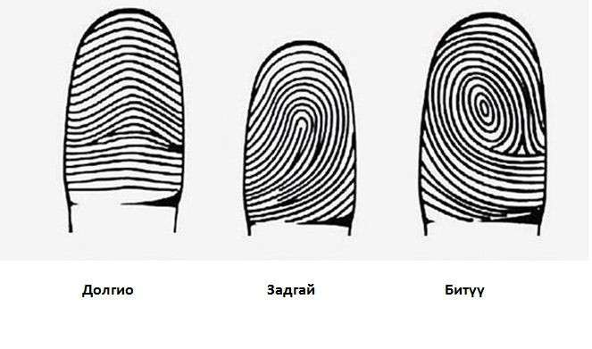
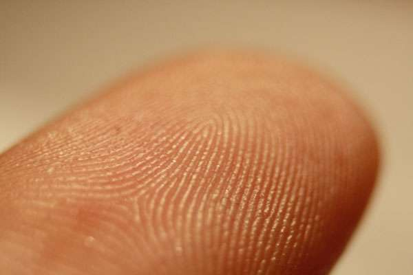

# Хурууны хээгээр шинжих нь

Гарын хурууны хээ нь, давтагдахгүй, өвөрмөц чанартай бөгөөд хурууны хээг судалдаг салбар ухааныг дерматоглифика гэдэг. Сэтгэл зүйчид, дактилоскопчид, криминалистууд гэмт хэрэгтний сэтгэл зүйг шинжлэхэд, энэ аргыг ашигласаар иржээ. Анх, албан ёсоор, 1892 онд, Ч. Дарвины үеэл, Ф.Гальтон, гарын хуруунууд нь хүний зан чанарыг илэрхийлдэг талаар хийсэн асар том судалгааны ажил хийснээр эхэлсэн аж. Тиймээс, гарын алга, хурууны хээ судлалыг, мэргэ төлөгийн хэмжээнд биш, шинжлэх ухааны үндэслэлтэй гэж үздэг. Та, гарынхаа хуруунуудын өндөг тус бүрийн хээг ажиглаарай. Тэдгээр дээрх хээ, долгио, задгай, битүү гэсэн гурван янз байдаг. Энэхүү хээнүүд, нэг хүний гарт, 2-3 янз байж болох ч, дан нэг хээтэй байх нь тун ховор байдаг байна.

#### Хуруун дээрхи “Долгио” хээ нь олон хүн

Энэ хээ, маш олон хүний хуруунд тархсан байдаг хээ юм. Ийм хүмүүс, тайван зантай, нийцтэй, тогтуун сэтгэхүйтэй байдаг. Тэнгэрээс од шүүрэхгүй, мөн эргэлзээтэй зүйлд оролцохгүй “Алтан дундач” хүмүүс. Их гэрсэг, гэр бүлсэг байдаг. Үйлчилгээний салбарын мэргэжил сонгож эрхлэх нь олонтаа. Долоовор хуруун дээрх “долгио” хээ нь, сэтгэлийн хөдөлгөөнтэй, эмзэг, нийтэч, хөнгөн шингэн хөдөлгөөнтэй, хариуцлагатай, үнэнч хүнийг заадаг. Маш сайн гүйцэтгэх ажилтан. Хэрэв, энэ хээ, баруун гарын хуруунууд дээр, зүүнээсээ олон байвал, түргэн зантай, гомдол нь амархан тайлагддаг, харин зүүн гарынх илүү бол, эсрэгээрээ байдаг. Эрхий хуруун дээрх энэ хээ, хэт өөрийнхөөрөө байдаг, туйлшрамтгай байдлыг харуулна.

#### “Задгай” хээ

Энэ хээ, төв европын оршин суугчидын гарт ихээр тархсан хээ. Маш илэн далангүй, өөртөө итгэлтэй, албан тушаалын баримжаалал сайтай, тодорхой материаллаг ашиг авч ирэхгүй ч байсан өөрийгөө хөгжүүлэх, таних, илэрхийлэхийг чухалчилдаг хүмүүс. Хуруунууд дээрхи энэ хээ олон байх тусам, тухайн хүн оюунлаг, оюуны хөдөлмөр эрхлэх магадлалтай байдаг. Ийм хүмүүс амбицтай, эрсдэлээс айдаггүй, аливаа зүйлийг эхлүүлэн санаачлагч, багаас эхлэн ихэд хүрэх чадвартай, ихэвчлэн хувийн бизнестэй байдаг. Эрч хүчтэй, чадварлаг, хурдтай хүмүүс. Эдгээр хүмүүсийг “дэлхийг эргүүлдэг” гэж нэрлэдэг. Долоовор хуруун дээрхи энэ хээ, багаар ажиллах чадвар, албан тушаалд шунадаггүй занг харуулах ба хүмүүстэй сайхан харьцаанд байдаг занг заана. Дунд хуруун дээр энэ хээ байвал, бусдын үзэл бодлоос ихээхэн хамаардагийг, харин, ядам, чигчий хуруунуудын энэ хээ, эрүүл мэндийн хувьд сайн болохыг заадаг. Судалгаагаар ийм хүмүүс багадаа өвдөмтгий байдаг, өсч том болоод эрүүл мэнд нь гайхалтай сайжирдаг гэсэн судалгааны үр дүн гарсан байдаг. Хэрэв, энэхүү “задгай” хээ 8-с дээш хуруун дээр байвал, мөрөөдөл, уран сэтгэмжид дуртай, “үүлэн дунд хөвдөг” гэсэн нэр зүүх нь бий. Бүр “энэ ертөнцийн хүн биш” гэцгээдэг. Ийм хуруутай хүмүүсээс, олон уран зөгнөлт зохиолчид төрж гарсан байдаг байна.

#### “Битүү” хээ

Хуруунууд дээр тань, энэ хээ хир их байна төдий чинээ, тархины тань потенциал өндөр байна. 10 хуруу нь, ийм хээтэй хүмүүсийг “суут ухааны тамга”-тай хүмүүс гэдэг. Ийм хээтэй хүмүүс маш ховор байдаг бөгөөд ихэнхи сод ухаантан, зохион бүтээгчид, том нээлтүүдийн эзэдийн хуруунууд энэ хээтэй байдаг ажээ. Ийм хээтэй хуруу олон байвал логик сэтгэлгээ өндөртэй, задлан шинжлэх гоц авъяастай, хэл шинжлэл, математикийн өндөр чадамжтай болохыг заана. Ийм хүмүүс, олон хэлийг чөлөөтэй эзэмших чадвартай, хижээл насандаа мэргэжлээ сольж, илүү сонирхолтой ажилд шилжих, шинэ зүйлийг эрэлхийлэх, цагаачлах зэрэг байдлууд гаргах нь бий. Эсвэл, тэр чигтээ, нэг үзэл бодолдоо үнэнчээр, тухайн ажилдаа бие сэтгэлээ зориулдаг. Материаллаг байдлыг анхаардаггүй талтай. Эрхий хуруун дээрхи энэ хээ, товойж сугарч гарах эрмэлзлийг илэрхийлэх ба түүний хувьд, үзэл санааны эрх чөлөөг эрхэмлэдгийг заана. Ердийн гүйцэтгэх ажил түүний хувьд, шийтгэл гэсэн үг. Хэрэв, эрхий хуруунуудаас бусад хуруун дээр энэ хээ байвал, сэтгэхүйн хувьд тогтворгүй хувь хүн. Ийм хүмүүсийн, хайр, үзэн ядалт хоёрын хоорондох зай нь бага гэж үздэг. Асар түргэн шийдвэрээ өөрчилдөг. Долоовор хуруун дах ийм хээ, тухайн хүн, олон ажилыг зэрэг авч, анхаарлаа төвлөрүүлэх нь удааныг эс тооцвол, ихэнхидээ амжилттай гүйцэтгэдэг чадвартайг заадаг. Амжилтад хүрэхэд нь, өдрийн тодорхой төлөвлөгөөнүүд, зохион байгуулалтын тодорхой журам хэрэгтэй байдаг. Харин, чигчий хурууны энэ хээ, шийдэмгий биш, зожиг, нийцгүй хүнийг харуулдаг бөгөөд ийм хүмүүс, хүнд итгэдэггүй, хүмүүстэй таарамжгүй, ганцаараа байх дуртайг заана. Хэрэв, хэн нэгэн итгэлийг нь олж авч чадвал, түүнээс илүү үнэнч найз, нөхрийг хаанаас ч олохгүй
