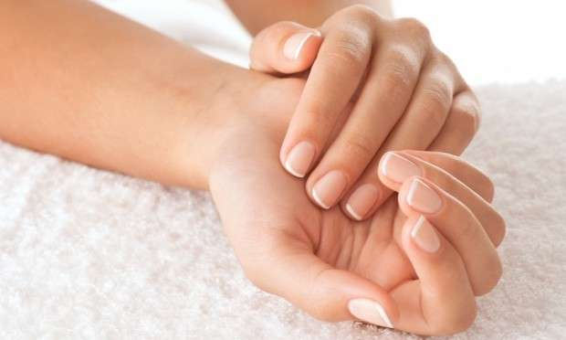
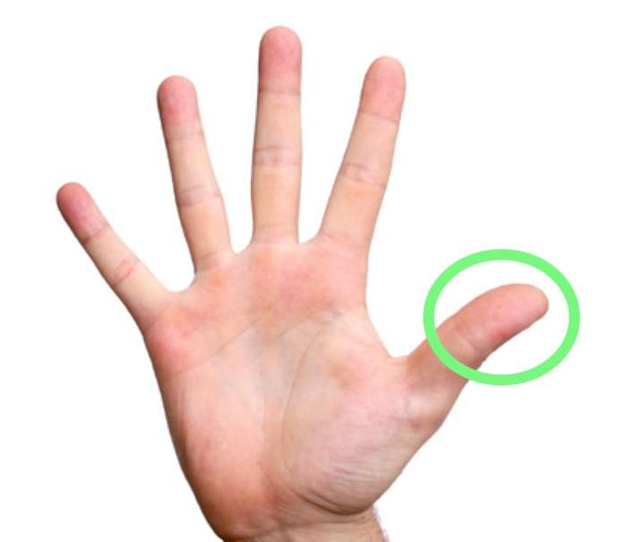
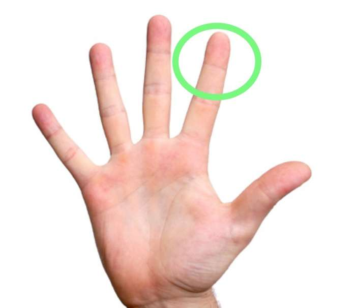
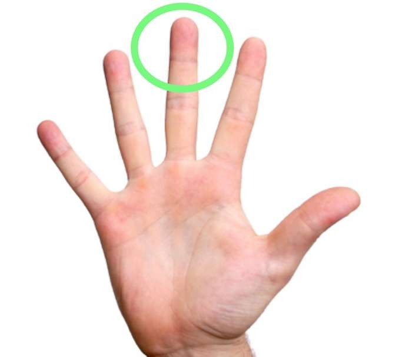
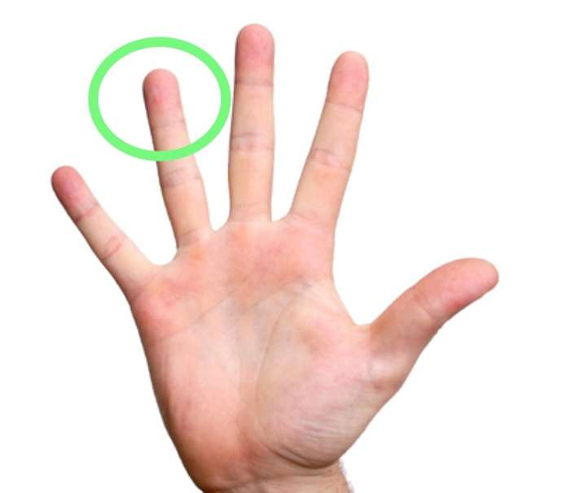
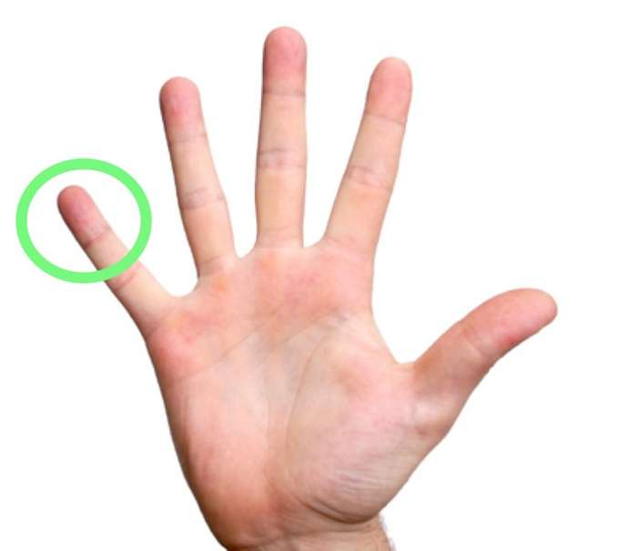

# Хурууны өндөгний массажны ашиг тус

Хүний хурууны өндгөн дээрх цэгүүд, биеийн тодорхой эрхтэнүүдтэй холбоотой байдаг бөгөөд өдөрт ганцхан минут хурууныхаа өндгөнд массаж хийж тухайн эрхтэнүүдийнхээ ажиллагааг сайжруулах хялбар аргатай танилцуулъя.

Эрхий хурууны өндөг, зүрх, уушигтай холбоотой байдаг. Зүрх өвдөх, “савлах” үед энэ цэгийг массажлах хэрэгтэй.

---

Долоовор хуруу. Гэдэс, хоол боловсруулах эртэний үйл ажиллагаанд нөлөөлнө. Гэдэс өвдөх, хоол шингэхгүй үед энэ цэгт массаж хийх тустай.

---

Дунд хуруу. Цусны эргэлтийг сайжруулна. Дотор муухай оргих, толгой эргэх, нойргүйдэх үед, дунд хурууны өндгийг массажлах хэрэгтэй.

---

Ядам хурууны өндгийг массажлах нь, сэтгэл санааны байдлыг тогтворжуулахад тустай бөгөөд сэтгэл санаагаар унах үед гайхалтай тусалдаг гэнэ.

---

Чигчий хурууны өндгийг, бөөрний үйл ажиллагааг сайжруулах, толгой өвдөх үед массажладаг. Мөн биеийн аль ч хэсгийн өвдөлтийг дардаг байна.
