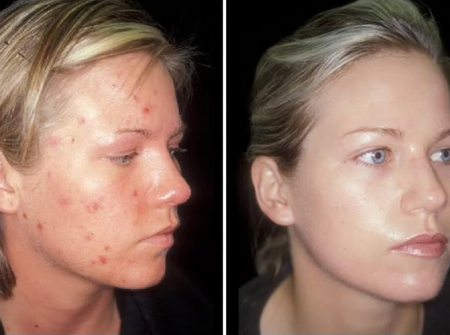
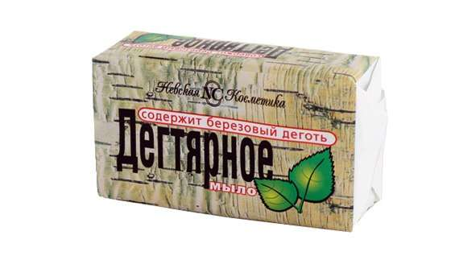
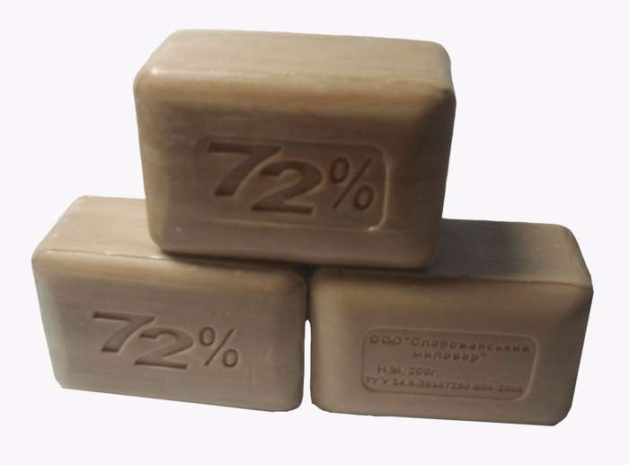

# Хусны давирхайны саван, барааны хар савангийн ашиг тус

Заримдаа байгал дэлхий бидэнд өгч буй ашиг тустай зүйлсээ тийм ч таатай бус үнэр, өнгө үзэмжтэй бэлдсэн байдаг нь харамсмаар. Хусны давирхайны саван, шүлтлэг барааны саван ийм л байдаг. Гэтэл эдгээрийн ашиг тустай чанар үнэлж баршгүй байдаг байна.

#### Хусны давирхайны саван:

Энэхүү саванг ердийн хуснаас гаргаж авдаг бөгөөд эмчилгээ, ашигт чанараараа бидний ашиг тусыг нь сайн мэдэх хусны шүүснээс дутдаггүй байна. Энэ саван ямар ч химийн нэмэлтгүй. Жинхэнэ байгаллаг чанартай бүтээгдэхүүн юм. Тиймээс ч ашигт чанарыг нь үнэлшгүй гэж үзсээр ирсэн ажээ. Нүүрний батга, хар нөсөө толбыг гайхалтай арилгадаг. Мөн ариутгах гайхалтай үйлчлэлтэй. Бөөстөлтөөс салгадаг. Арьсны псориаз, демодекс, лишай бусад арьсны өвчнүүдийг шууд үйлчлэлээр эмчилдэг. Арьсны аливаа үрэвслийг дарна, гэмтлийн ил шарх, зүссэн шарх дерматитад хэрэглэдэг. Арьсны нүхжилтийг багасгаж толигор болгоно. Өглөө оройд бүлээн усаар давирхайн савангаар угааж хүйтэн усаар зайлахад маш үр дүнтэй байдаг. Мөн маск маягаар, хөөсрүүлээд хөөсийг нь 10-15 минут байлгаад бүлээн усаар угааж, тэжээлийн тос түрхдэг. Үсний бүтцэд сайн нөлөөлж өтгөрүүлж гялалзуулдаг. Сайтар зайлах хэрэгтэй байдаг. Шампуньны оронд хэрэглэх хэрэгтэй. Жилд хэд хэд удаа курс маягаар хэрэглэдэг. Эмэгтэйчүүдийн өвчний үед бэлэг эрхтэний гадуур угаалга маягаар хэрэглэхэд халдвараас сэргийлэх үйлчлэл үзүүлдэг. Эвгүй үнэр нь, усаар сайн зайлсны дараа оргүй арилдаг. Дагавар муу үр нөлөө байдаггүй. \
Гэрийн тэжээмэл амьтдын бөөстөлтөд мөн хэрэглэж болно

---

#### Барааны хар саван:

Халдвараас сэргийлэх шинж чанартай. Шархыг хөөсрүүлэн угаахад цусанд халдвар орохоос бүрэн сэргийлдэг. Шүдний сойзыг ариутгах гайхалтай хэрэгсэл, орой бүр хөөсрүүлж угааж байх хэрэгтэй. Хөлний мөөгөнцрийг арилгана. Түлэгдсэн биеийн хэсэгт савангаа норгож түрхэхэд ус гүйхгүй түргэн эдгэнэ. Долоо хоногт нэг удаа нүүрээ угаахад нүүрний арьсны бүтэц гайхалтай сайжирна. Нүүрний арьсны бактеруудыг устгаж, илүүдэл тослогийг арилгадаг. Бактерын эсрэг зориулалтын савангаас химийн нэмэлтгүй учраас илүү аюулгүй байдаг. Үсний хагийг арилгадаг. Эхний угаалтуудад үс хуурайшиж гэмтсэн мэт болдог боловч дараа дараагийн угаалтуудаас гялалзаж эрүүлждэг. Геморрой өвчний үед тэр хэсгээ массажлан чихэх маягаар угаахад үр дүнтэй. Ханиад томууны үед гарахаасаа өмнө энэ савангийн уусмалаар хамраа угаахад халдвараас сэргийлдэг. Эмэгтэйчүүдийн цагаан зүйл ялгарах өвчний үед мөн угаах хэрэгтэй. Аль ч тохиолдолд хэрэглэх үедээ арьсны хуурайшилтыг анзаарч завсарлан хэрэглэж байх хэрэгтэй.
