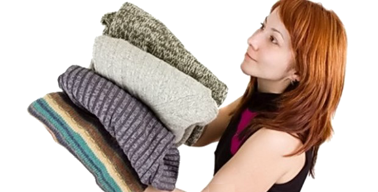

# Хуучин эд зүйлсээ хүнд өгөхөд анхаарах зүйлс

Хуучин эд зүйлсээ хэрэглэхээ больж хэн нэгэн хэрэгцээтэй хүнд өгөх үе, үргэлж гарч байдаг бөгөөд хүний өмсөж зүүдэг, эдэлж хэрэглэдэг эд зүйлс, тухайн хүнийхээ зан байдал, амьдрал ахуйтай холбоотой энергийг шингээсэн байдаг байна.

Эдгээр бүх зүйлс тухайн хүний энергитэй холбоотой ба хэн нэгэнд өгөх үедээ энергээ хамт өгч байдаг гэсэн үг бөгөөд тухайн хүнтэй энергийн холбоо үүсгэдэг гэж үзэх ба үр дагавар нь ямар ч байж болох аж. Хүнд энергээ өгөх ба авахын, аль алийг нь таагүй гэж үздэг. Тиймээс, өгөх гэж буй зүйлсээ давстай усанд угаах, арчиж цэвэрлэн өгөхийг зөвлөдөг. Мөн өгөхөөр төлөвлөсөн зүйлсээ, тусад нь угаах хэрэгтэй бөгөөд бусад хэрэглэдэг зүйлсээсээ тусад нь хадгалах, эсвэл шууд өгөх хэрэгтэй байдаг байна. Ингэснээр, өөрийгөө хамгаалаад зогсохгүй тухайн хүнийг ч мөн хамгаалж өгдөг аж.
