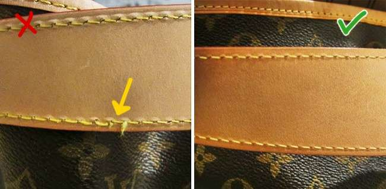

# Хувцас, эд зүйлийн чанарыг шалгах арга

Дэлгүүрт, эд зүйлсэд баталгаа өгдөггүй 3 зүйл байдаг бөгөөд эдгээр нь, үнэ, бренд, онцлох зүйл юм. Гэхдээ, Chanel-ийн эд зүйлсийг үүнд хамааруулаагүй юм шүү. Энэ брендийн бүтээгдэхүүнүүдийн чанар, элэгдэх хугацаа, эдэлгээ, онцгойрох загварын хувьд баталгаатай байдаг. Харин, дэлгүүрээс худалдан авч байгаа хувцасны чанар, үнэ, онцлог ихэнхидээ, чанарын баталгаанаас илүү маркетингийн бодлогод тулгуурласан байдаг байна.

1/ Хувцасны цахилгаан, товч, кнопкуудад нэн түрүүн анхаарч шалга. Цахилгаан нь, үл ялиг ч бай гацах, татагч нь хэврэг харагдаж байвал, уг хувцасыг үйлдвэрлэхдээ ихээхэн хэмнэлт гаргасан гэсэн үг. Товч, кнопкууд хүндэвтэр жинтэй байх ёстой. Одоо, эдгээрийг хуванцраар, төмрөөс ялгахын аргагүй хийдэг болсон. энэ нь хэврэг байх нь ойлгомжтой\
2/ Хувцсаа өмсөж үзчихээд, материалын нягтшилыг шалгаж, алган дээрээ сунгаж нэвт гэрэлтэж буй эсэхийг хараарай. Залуучуудад зориулсан хувцаснууд дээр, ялангуяа, материалын хэмнэлт гаргадаг болсон байгаа шүү. Мэдээж зориулалтын сиймгэр даавуугаар хийсэн хувцас үүнд орохгүй нь ойлгомжтой\
3/ 100% натурал материалаар хийсэн хувцас олж өмсөх бэрх болсон цаг. Гэхдээ, натурал утасны орц хир өндөр байна төдий чинээ эдэлгээтэй байдаг гэдгийг бүү мартаарай. Хөдөлгөөнд эвтэй байх талаас тооцсон, бэлтгэлийн хувцас джинсэн хувцас үүнд орохгүй\
4/ Олноор үйлдвэрлэгддэг, захиалгандаа дарагдсан үйлдвэрүүд, оёдолын чанарт анхаардаггүй. Ямартай ч оёдолыг нь анхаарч хар\
5/ Хувцасны эдэлгээ оёосноос их хамаардаг. Сонирхолтой нь, эрэгтэй хувцасны оёосыг илүү бөх хийдэг. Таалагдсан свитерээ, эрэгтэй тасгаас аваад өмсчихөд алдахгүй\
6/ Хувцас солих өрөөнд байхдаа, тухайн хувцасныхаа материалыг, хэсэг газарт чангахан атгаж базаад үзэхэд, үрчийгээд тэнийхгүй байвал, та, өглөө бүр индүүдэх шаардлагатай хувцас авч байна гэсэн үг. Ийм хувцаснууд ихэвчилэн, өмсөгдөхөөс илүү, хувцасны шүүгээнд байраа эзэлдэг юм шүү\
7/ Хээтэй, том том хээтэй хувцасны оёосны чанарыг амархан шалгаж болно. Яг л ханын цаас наах үетэй адил, хээ нь хоорондоо таарсан байх ёстой байдаг\
Эдгээр зөвлөгөө, мэдээжийн ойлгомжтой мэт санагдавч, үнэ чанар хоёрын харьцааг тааруулан авах, харьцангуй чанартай хувцсаар шүүгээгээ дүүргэхэд тань тус болно.
