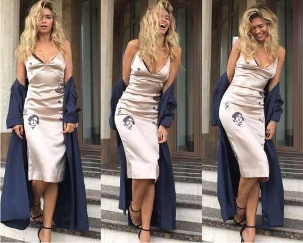
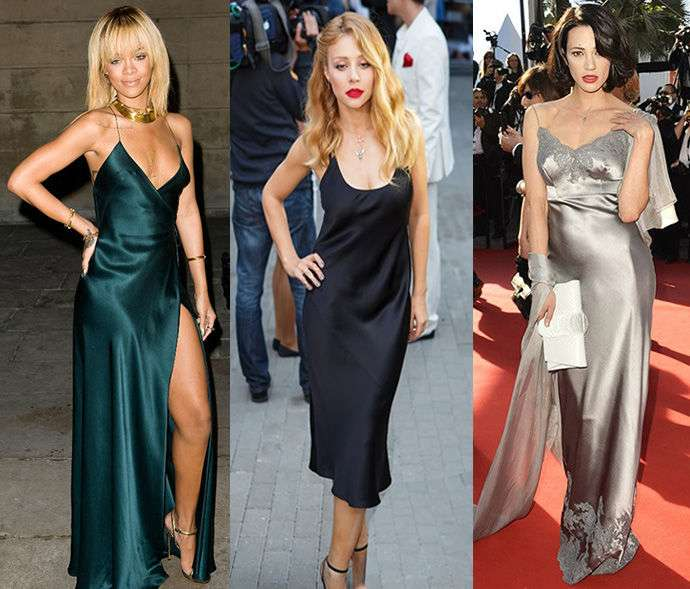
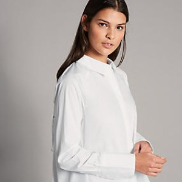
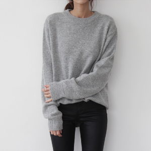
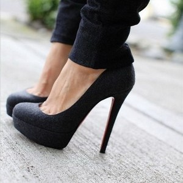
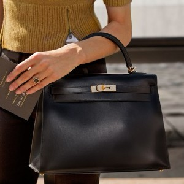
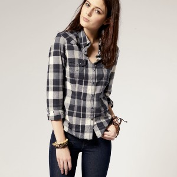

# Хувцаслалтыг үнэтэй, чинээлэг нүнжигтэй харагдуулах 6 зүйл

-Торгомсог даашинз. Хувцасны шүүгээн дэх даашинзнуудын хатан хаан л гэсэн үг. Чимэг зүүлт, цүнх, хүзүүний алчуураар чимээд хаана ч өмссөн авраад гарчихдаг хар даашинзнаас ч илүүтэй, торгомсог бөсөөр урлагдсан, нарийн мөртэй, дотуур хувцасны загвартай даашинз сэтгэл хөдөлгөм дүр төрхийг бүтээдэг аж. Үдэшлэг цэнгүүнд, олом оосортой задгай өндөр өсгийт, бүр өдөр тутмын урт түрийтэй гуталтай ч хослуулан өмсдөг. Нэхмэл, торон задгай цамц, гинжин оосортой цүнх зэрэгтэй зохицдог бөгөөд чинээлэг тансаг хатагтайн дүр төрхийг бүтээхэд тусалдаг гэнэ.

---

-Цагаан цамц. Энэ цамц хувцаснууд дундах гол зүйл. Уламжлалт, сонгодог загварын цагаан цамц шиг, богино хугацаанд шинэ сэргэг, гоёмсог, чинээлэг харагдуулах зүйл байдаггүй гэнэ. Загвар нь классик, материал нь нягт байх ёстой байдаг.

---

-Ноолууран битүү цамц. Ердийн, даруухан саарал өнгийн ноолууран цамц л гэхэд есөн шидийн бусад хувцасыг цохиод гарах чадвартай. Загварынхан, 5 ширхэг синтетик цамцтай байхын оронд нэг ноолууран цамц худалдан авахыг зөвлөдөг байна.

---

-Өндөр өсгийт. Биед эвтэй, өдөр тутмын хувцас хэрэглээг эрхэмлэх болсон эрин зуунд өндөр өсгийт өмсөх нь ховордож байгаа хэдий ч, энэхүү “гайхамшгийг бүтээгч” өндөр өсгий нь алхаа гишгээ, бие галбир, харцыг ч хүртэл өөрчилж, дүр төрхийг баян тансаг харагдуулах чадвартайг сануулах нь зүйтэй. Нарийн өндөр өсгийтэй гутал нь брэнд биш эсэхээс хамаардаггүй сайхан харгдуулдаг аж.

---

-Зөөлөн биш, хатуувтар материалаар урлагдсан хэлбэрээ барьдаг цүнх. Ажил хэрэгч дүр төрхийг илэрхийлэх хандлагын нэгдүгээрт ийм цүнх бичигддэг гэнэ. Эмэгтэй хүн, хэр өндөр албан тушаалтай байна төдийчинээ цүнх нь хатуу байдаг гэсэн судалгаа гарсан байдаг. Хатуувтар материалтай, хэлбэрээ хадгалдаг цүнх нь заавал бренд байх шаардлагагүй чинээлэг, ажил хэрэгч харагдуулдаг байна. Богино бариултай цэвэр арьсан цүнх, үнэтэй брэнд сүрчигнээс дутахгүй тухайн хүн аливаа зүйлийн чанар эдэлгээг мэддэг, чинээлэг гэсэн дүр төрхийг харуулдаг байна.

---

-Дөрвөлжин хээ. Материалын үнэ цэнээс гадна дөрвөлжин хээ үнэтэй харагдуулдаг. Энэ хээг ордныхон дуртайяа хэргэлдэг байсныг, уг хээ нь, баян тансаг, нүнжигтэй зүйлстэй сайхан хоршдог байсантай холбон үздэг. Үүнийг, английн Burberry брэнд зуугаад жил амжилттай ашиглан үргэлжлүүлсээр байгаа аж.
