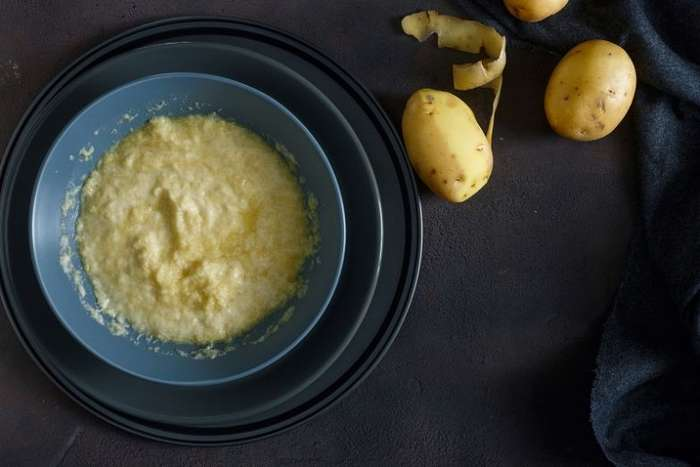
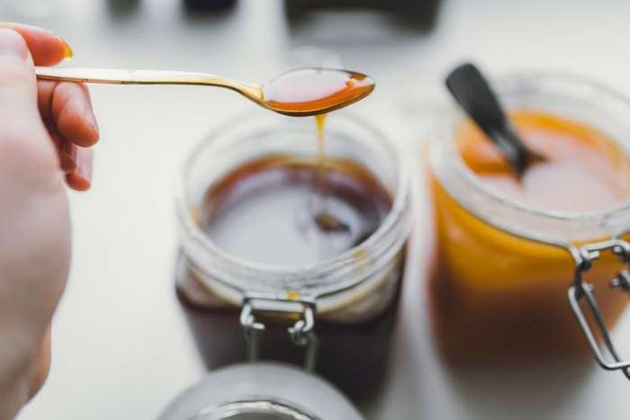

# Хуянгаас салах хялбар арга

Орчин үеийн амьдралын хэв маягийн өөрчилөлтөөс үүдэлтэй, суугаа ажил төрөл эрхлэлт, хөдөлгөөний дутагдалтай холбоотой хамгийн их дэлгэрсэн, олны дунд хуян гэж нэршсэн, хүзүү хөших, өвдөх, толгой өвдөх, толгой эргэх, хараа муудах, байнга ядарч сульдах, нойр ханахгүй байх зэргээр илэрдэг, тархины цусны эргэлт, цусан хангамжийг муутгаж байдаг аюултай үр дагавартай өвчилөл нь, хүзүү хэсгийн үе хэсэгт давс хуралдсанаас үүсдэг. Энэхүү хүзүүний остеохондроз, богино хугацаанд үүсч өвчин болдоггүй, 6 сарын турш явагддаг. Хэрэв, хүзүү хавьд өвдөх, хөших байдал ажиглагдаад эхэлсэн бол дараах компресс үр дүнтэй байдаг.

Орц:

-Төмс

-Зөгийн бал

-Шилмүүст модны эфирийн тос

Бэлтгэх:

Түүхий төмсийг үрүүлээр үрж жижиглээд ижил хэмжээний зөгийн балтай хольж хүзүү хэсэгтээ шавж түрхээд цаас тавьж гадуур нь алчуураар ороож тогтооно. 2 цаг орчим байлгаад салфеткаар арчиж цэвэрлэн, тэр хэсгийнхээ арьсанд шилмүүст модны эфирийн тос түрхнэ. 7-10 өдөр хэрэглэх хангалттай. Энэ компресс, арьсаар нэвчин хуралдсан давс, токсиныг татах, үрэвсэл дарах, өвдөлт намдаах үйлчилэл үзүүлдэг байна.

---

---

