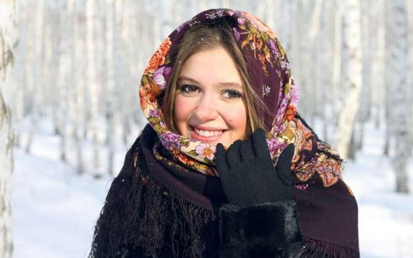

# Хятадын бизнесменүүд, орос гэргийтэй болохын тулд Сибирь рүү хошуурцгааж байна

Британийн Daily Mail сонин, хятадын бизнесменүүд, “эхнэр олох аялалд” багагүй мөнгө зарцуулан, Сибирийн, “цэнхэр нүдэн, цагаан арьст бүсгүйчүүд”-ийг, гэргийгээ болгохоор хошуурцгааж байна гэж мэдээлжээ

Энэ аялалд, тэд 1000 орчим паунд зарцуулдаг ба ийм мөнгөний чадалгүй зарим нь, “цэнхэр нүдэн”-гүүдийн сэтгэл зүрхийг уяраахаар, эдгээр хязгаар нутгуудын цэнгээний газруудаар, саксофон хөгжим тоглож, хайрын аялгуу уянгалуулдаг болсон гэнэ. Энэхүү аялалын зуучлагч, Елена Суворова, хятад эрчүүд, эмэгтэйчүүдийг хүндэлдэг хүмүүс, тэд эмэгтэй хүний “тайван зан, инээмсэглэл дүүрэн царай, эрэгтэй хүнтэй уралдаж, дээр нь гарах гээд байдаггүй” зан чанарыг ихэд чухалчилдаг юм байна гэж ярьжээ. Хятадын “нэг хүүхэд” бодлого, мөн ард түмнийх нь, охин хүүхэд гаргах нь, удам тасрана гэсэн харалган үзлээс нь болж, 120 эрэгтэйд, 100 эмэгтэй ноогддог, хүйсийн харьцаа алдагдсан байдалд хүрээд байгаа юм гээд харин Оросод, эсрэгээр 100 эмэгтэйд, 85 эрэгтэй ноогдох харьцаатай байгаа гэж дурдаад авчээ.

Ийнхүү, хятад, оросын худ ургийн хэлхээ өргөсч, “хайрын аялал”-аас хятад эрчүүд, ганзага хоосонгүй буцаж байгааг, хаа холын Англи сонин мэдээлж байх юм. Иймэрхүү, улс дамжсан “хайрын зуучлал”, юунд хүргэх бол? Асуултын хариуг танд үлдээе.

Хятад эрчүүдийн “хайрын шалгуур”-ыг нь,тогтож уншаарай, хэн хэнгүй... !!!
