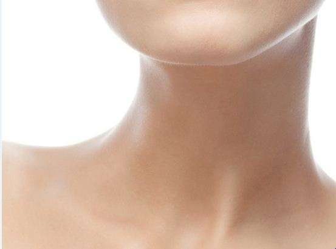

# Хүзүүний арьс чангалж, толигор болгох маска

Үр дүн нь гайхалтай. Нас ахих тусам, хүзүүний арьс унжиж, үрчлээтэн өнгөө алдаж, задгай хувцас өмсөхөд хэцүү болдог. Энэ маска, долоо хоногт 2-3 удаа хийхэд, хүзүүний арьсыг зөөлөн толигор болгодог.

Орц: \
1. 2 цайны халбага, нунтаг куркума\
2. 3/4 стакан элсэн чихэр\
3. 3-4 дусал эфирийн тос\
4. 1/3 стакан ургамлын тос\
5. Чимх ваниль\
Тараг масканы дараа түрхэхээр хэмжээний\
Дээрх, 5 орцыг хооронд нь хольж, хүзүүндээ түрхээд, 20 минутын дараа, тойрог хөдөлгөөнөөр массажлах маягаар угаана. Дараа нь тарагаа түрхэнэ. Куркуманы өнгө, арьсанд бага зэрэг ордог тул, тараг арьсыг цайруулж өгөх үүрэгтэй юм.
