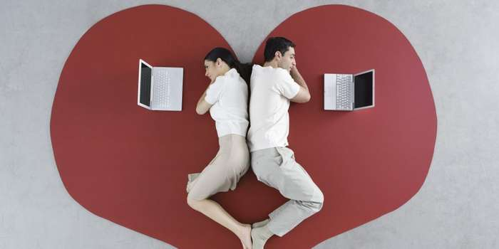

# Компьютер, харилцаанд сөрөг нөлөөтэй

Хүмүүс аргагүйн эрхэнд гар утас, компьютерээсээ холдох шаардлага гарвал ихэд догдолж эхэлдэг гэнэ. XX зууны сүүл XXI зууны эхээр дэлхийн хуучин аюул заналууд дээр шинэ аюул нэмэгдлээ. Өлсгөлөн, дайн, өвчин, алан хядлага зэргийг хүн төрөлхтөн нилээд эртнээс мэдэх бол нэгэн шинэ аюул бий болж, үхэл үгүй юмаа гэхэд сүйрэл учруулсаар байна. Хүний харилцаанд учирч байгаа шинэ аюул бол КОМПЬЮТЕР.

Ямар ч гэсэн Америкийн судалгааны “Kelton Research” фирмийн мэргэжилтнүүд ингэж дүгнэжээ. Асуулгад оролсон, нас биед хүрсэн 1000 америкийн 65% нь хань ижил, амрагтайгаа бус харин компьютер дээр их цаг өнгөрөөж байна гэж мэдэгджээ. Интернэтэд эрчүүд голдуу ганцаар тэнэдэг бол харин эмэгтэйчүүд ихэнхидээ хамаатан садан, найз нөхөдтэйгээ харилцах гэж суудаг байна. “Компьютер хэрэглэгч” хэмээх хосын харьцаа улам гүн болж буйг судлаачид тэмдэглэв. Оролцогчдын 84% нь сүүлийн 3 жилийн дотор компьютерээсээ хамааралтай болсон байна. Компьютер хэрэглэгчдийн 52% нь компьютер алдахад эсвэл удаан ажиллаж, тусламжид хариу өгөхгүй бол өөр шигээ үзэж, уур хилэн, гуниг, сэтгэлийн хөрөлт мэдэрдэг байна. Мөн 19% нь компьютерээ цохиод авмаар санагддаг гэжээ. Кибер стрессийн үед бид гэр бүл болон хань ижлээсээ тусламж хүсдэг. Судлаачдын үзэж буйгаар америкчуудын компьютертай харьцдаг харьцаа гэр бүлд нь нөлөөлдөг аж. Америкчүүдийн 74% нь энэ асуудлаа гэртээ авчирдаг байна. “Компьютерууд улам хүчтэй болж, бидний амьдралын бүх хүрээнд эрчимтэй нэвтрэхийн хэрээр тэдэнтэй харьцах харьцаа бидний гэр бүлийн хүнтэйгээ харьцах харьцааны адил тийм чухал болдог байна. Компьютер нь эвдрэхэд уур уцаар хүрч, бухимддаг, тэвддэг” гэж Манхэттэний гэр бүлийн сэтгэл зүйч Роби Людвиг мэдэгдлээ. Компьютер хүмүүст адил боломж өгдөг, эмэгтэйчүүдийн 69%, эрэгтэйчүүдийн 71% буюу 141 сая хүн тогтмол Интернэт хэрэглэдэг байна. Мэргэжилтнүүд одоохондоо интернэт эмгэг, хамаарал үүсгэдэг талаар маргасаар байна. Станфордын их сургууль өнгөрсөн жил хүмүүсийн 6% нь компьютерээс болж хувийн харьцаанд нь өөрчлөлт гарч шаналж байгааг анзаардаг тухай мэдээлсэн. 14% нь биеэ барьж, компьютерын ард суухгүй “тэвчиж” чаддаг гэнэ. Массачусетсийн сэтгэл зүйч, доктор Эдвард Хеллоуэлийн үзэж буйгаар харилцааны олон хэрэгсэл хосуудад саад болдог байна. Эрдэмтэн Мерло “Гар утас идэвхитэй хэрэглэдэг хүмүүс түүнээ багасга. Утсаа унтраачих. Мэдээлэл ирээд тэндээ хадгалагдаж байг” гэж зөвлөж байна.
