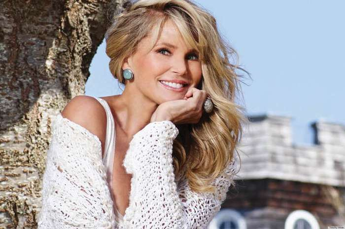
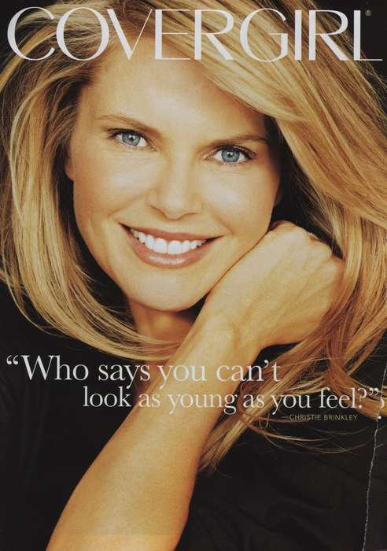
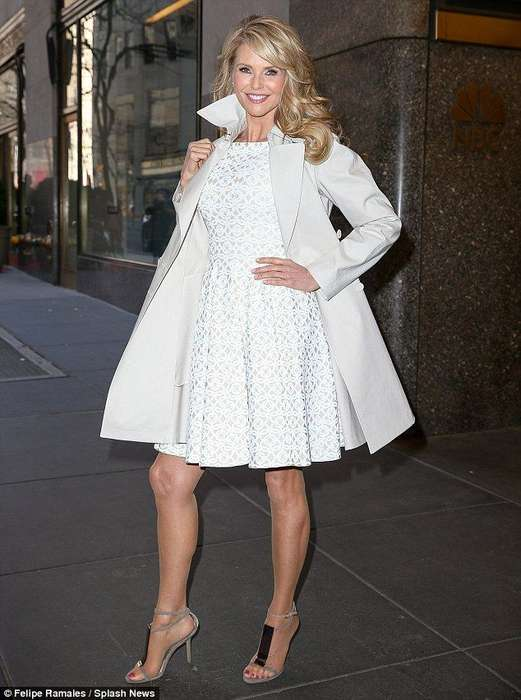

# Кристи Бринкли: Нас бол тоо юм

Кристи Бринкли 61 настай. Үеийнхэн нь, тэтгэврийн бичиг баримтаа бүрдүүлэн явж байхад, харин Кристи алдартай сэтгүүлийн зураг авалтад усны хувцасны рекламын зураг авахуулж байдаг. Түүний хувьд “хөгшрөлт” гэдэг үг, ердөө нэг хоосон авиа гэнэ. Тэрээр, 60 насныхаа ойн баяр дээр People-н сурвалжлагчид өгсөн ярилцлагадаа, -“Би 60 нас хүрч байгаа даа баяртай байна. Яг л, амьдралын оргилд гарсан юм шиг байна” гэж хэлсэн байдаг. 1973 оноос, одоог хүртэл загвар өмсөж байгаа бөгөөд энэ хугацаанд 500-д сэтгүүлийн хавтсан дээр зураг нь тавигджээ. 1980-д оны дундуур, загварын ертөнцийн түүхэнд байгаагүй хамгийн урт 20 жилийн гэрээг, гоо сайхны CoverGirl компани түүнтэй хийж, 2005 онд үргэлжлүүлэн сунгажээ. Одоо Кристи загвар өмсөхөөс гадна зохиолч, фото зурагчин, загвар зохион бүтээгч, дуучин зэрэг олон төрлийн мэргэжлээр ажилладаг. Тэр, 3 хүүхэдтэй, өнөр гэр бүлийн сайн эзэгтэй ба өөртөө итгэлтэй, эрч хүчээр дүүрэн амьдардагаа өөрийн мөрддөг дараах дүрмүүдтэй холбон үздэг.

---

1. Биологийн насныхаа тухай огт боддоггүй. Нас бол тоо 2. Цагаан хоол идэхийг эрхэмлэдэг, гэхдээ амттай зүйлээс бас татгалздаггүй. Амьдрал уйтгартай болно гэж үздэг 3. Хувцасныхаа размерт огт санаа зовдоггүй. Биеийн жин нь их хэлбэлзэлтэй байдгаас түүний хувцасны өрөөнд 40-44 размерын джинс байхыг огтхон ч тоодоггүй, аль таарсанаар нь өмсч байдаг. 4. Биеийн тамирын дасгал сургуулилалт, спортгүйгээр өөрийгөө төсөөлж чаддаггүй 5. Хэт задгай хувцасладаггүй. Зохимжид нь их анхаардаг. 6. Гэр бүлээ нэгдүгээрт тавьж хүүхдүүддээ анхаардаг. Хүүхдүүд болон өөрийнхөө өмнө өндөр хариуцлагатай байх ёстой гэж боддог
