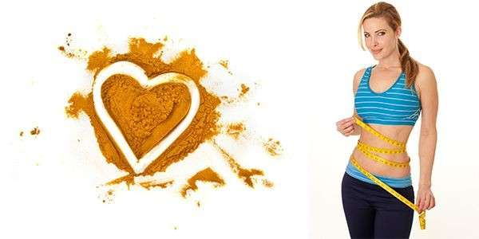
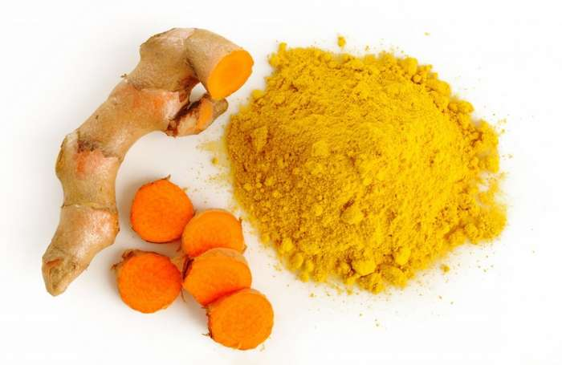

# Куркума буюу турмерикийн ашиг тус

Куркума нь, энэтхэгээс гаралтай, цагаан гааны төрлийн ургамал юм. Ихэвчлэн хоол амтлагч, хүнсний будаг маягаар хэрэглэгдэж ирсэн бөгөөд одоо ашигт чанаруудыг нь судалж эмчилгээ гоо сайханд өргөнөөр ашигладаг болсон байна.

Гол шинж чанар нь биеэс бүх муу зүйлсийг гадагшлуулж эрүүлжүүлдэгт оршдог аж. Эмч, мэргэжилтнүүд куркума, хорт хавдараас сэргийлэхэд тустайгаас гадна хорт хавдартай тэмцэх, дарах чадвартай гэдэг дээр санал нийлдэг. Куркума-ны найрлага дах, куркумин хэмээх бодис нь хорт хавдарын эд эсийг бусад эрүүл эрхтэний эд эсийг гэмтээхгүйгээр устгах, зогсоох чадвартайгаас гадна куркума нь, цинеол, тумерон, Р амин дэм, залуужуулах болон хавдар үүсэхээс сэргийлдэг антиоксидантуудаар баялаг байдаг. Түүнээс гадна ходоодны шархлааг эмчилж гэдэсний бичил орчны эрүүл байдлыг хангадаг бөгөөд цусан дах холестериныг бууруулж, цусыг цэвэрлэж гемоглобины тоог өсгөдөг байна. Альцгеймерын өвчин, ой санамж буурах, мартах зөнөглөх өвчнийг эмчилдэг. Мөн саяхны судалгаагаар түрүү булчирхайн хорт хавдарыг эмчлэх болон хавдрын өсөлтийг зогсоодог болохыг нотолжээ. Чихрийн шижин өвчин, ясны сийрэгжилтийг үр дүнтэй эмчилдэг. \
-Тал цайны халбага куркумаг тал стакан халуун сүүтэй хутгаж өлөн элгэн дээрээ уух, хоол идээгүй үедээ өдөртөө 2 удаа мөн ингэж уухад астма өвчний бачуурлыг эмчилнэ. \
-Чихрийн шижин өвчний үед өдөрт 3 удаа хоолны омнө ¼ цайны халбага дотуур хэрэглэх хэрэгтэй. \
-Гэмтэл, хөхрөлт няцралтын үед, 2 цайны халбага куркума, 2 цайны халбага давстай хольж тавихад өвчин нь намдаж, хөхрөлт түргэн эдгэнэ. Шархан дээр куркума-ны нунтаг цацахад цус тогтно. Түлэгдэлтэд куркумаг зуун насттай тэнцүү хэмжээгээр хольж хэрэглэхэд, ариутгаж, үрэвслийг дардаг. \
-Салхинд цохиулах хоолой өвдөхөд. 1 цайны халбага куркума, 1 цайны халбага давс, 100 мл устай найруулан 3 өдөр хоолойгоо зайлах\
**Гоо сайхны зориулалттай арьсанд дотуур болон гадуур хэрэглэнэ.**\
-тослог арьсны маска: 2 өндөгний цагааныг 1халбага куркуматай хольж цэвэрлэсэн, чийгтэй арьсанд түрхээд 15 минутын дараа бүлээн усаар угаана\
-үрчлээний эсрэг маска: 1 цайны халбага куркумаг 2 хоолны халбага цөцгийтэй хутган нүүрэндээ түрхэж 30 минутын дараа бүлээн усаар угаана\
**Куркума тураах үйлчилгээтэй.** Гэхдээ хэтрүүлэн хэрэглэж болдоггүй. Өдөрт 2-2.5 граммаас хэтрэхгүй байх ёстой. **Турахын тулд:** \
-хагас цайны халбага куркумаг 1 стакан усанд найруулан, өдөрт 1-2 удаа, хооллох үедээ эсвэл хоолны өмнө ууна\
-куркуматай ундаа. 400 мл байхуу цайнд хэдэн хэрчим цагаан гаа, чимх корица, 1 хоолны халбага куркума хийж өглөө ба орой ууна\
-1 стакан бүлээн сүүнд 1 халбага куркума хийж хутгаад өдөрт 2 хувааж ууна \
-мөн хоолондоо амтлагч маягаар хэрэглэхэд тураах үйлчлэл үзүүлдэг. Будаа, тахиа загастай их зохицдог. \
Куркумаг хоолонд нэмж хэрэглэхдээ тосонд уусдаг чанартай тул бага зэргийн ургамлын тосонд найруулж хэрэглэдэг. Мөн хар перецтэй хамт хэрэглэхэд гэдсэнд шимэгдэх чанар нь сайжирдаг. \
Хөхүүл хүүхэдтэй эхчүүд, жирэмсэн эмэгтэйчүүд, цөсний чулуутай хүмүүс, үсний асуудалтай хүмүүс, хагалгаанд орох гэж буй хүмүүс, 3 нас хүрээгүй хүүхэд, эмийн эмчилгээтэй хамт хэрэглэж болохгүй. Ахуйн талаас зөвлөхөд, куркуманаас тогтсон толбо арилдаггүй.
