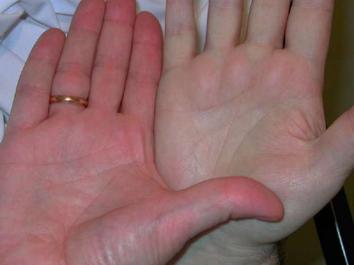
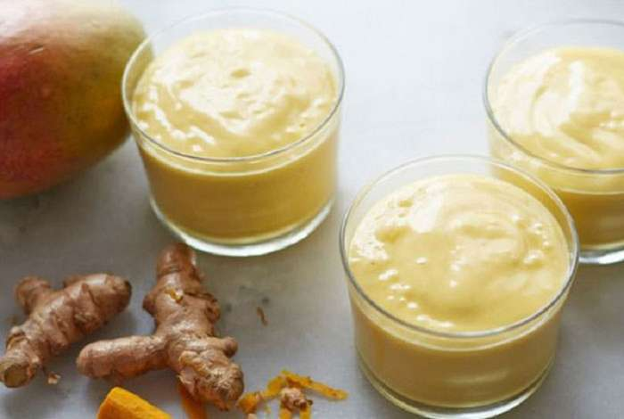

# Куркума олон төрлийн эмийг орлох чадвартай

Куркумаг, хүнсний будагийн хэмжээнд өргөн хэрэглэж ирсэн бөгөөд олон төрлийн өвчины үед, тухайн өвчинүүдэд зориулагдсан эмийг орлуулах чадвартай гэдгийг сүүлийн үеийн олон судалгаагаар нотолж, дэлхий нийтээр эмчилгээний зориулалтаар хэрэглэж үр дүн нь нотлогдсоор байгаа юм. Эмчилгээний журмаар хэргэлэх жоруудыг хүргэе:

1. Куркуманы ундаа. “Алтан сүү” гэж нэрлэдэг бөгөөд яс, үе мөчний өвчин, артритыг эмчилдэг. 2 хоолны халбага куркума, 1 стакан сүү, 1 стакан ус ордог. Усандаа куркумаг хийж 10 минут буцалгахад өтгөвтөр зуурмаг болно. Үүнийг 1 сар хөргөгчид хадгалах боломжтой. Бүлээн сүүнд, үүнээсээ 1 хоолны халбагыг нэмж ууж хэрэглэнэ.

---

2. Куркумаг цэцгэн байцаатай хамт хэрэглэх нь түрүү булчирхайн хавдараас сэргийлдэг. Цэцгэн байцаагаа хайруулын тавганд, 1 хоолны халбага куркума нэмж зөөлөн гал дээр жигнэнэ.

---

3. Цус багадалтын үед, 1 цайны халбага зөгийн балыг 4/1 цайны халбага куркуматай хутган өглөө бүр цайны өмнө хэрэглэдэг.

---

4. Куркума чихрийн шижнийг эмчлэх өндөр чадвартай. Энэ ургамал цусандах сахарыг бууруулахаас гадна жин хасах үр дүнтэй. ¼ цайны халбага куркумаг хоол, цайны өмнө өдөрт 3 удаа хэрэглэнэ.

---

5. Бактерийн эсрэг үйлчлэлтэй тул, шарх, үрэвсэлд чимх куркумаг түрхэхэд хурдан эдгэдэг.

---

6. Өдөр бүр 1 цайны халбага куркумаг хоолонд нэмж хэргэлэхэд хөхний хавдараас бүрэн сэргийлнэ.

---

7. Оройд унтахын өмнө, аяга сүүнд чимх куркума, цайны халбага зөгийн бал хольж уухад бие организм хорт бодисуудаас бүрэн цэвэрлэгдэж байдаг.

---

8. Хүйтний улиралд хоолой өвдөх үед, 1 цайны халбага давс, ½ цайны халбага куркумаг 1 аяга бүлээн усанд хийж, хоолойгоо зайлна.

---

9. Арьсны түлэгдэлд, зуун настын шүүс, куркумаг тэнцүү хэмжээгээр хольж түрхнэ.

---

10. Арьсны идээт үрэвсэл, тууралтын үед, цөцгийн тос, куркумаг хольж түрхдэг.

---

Арьсны нүхжилтийг багасгаж, хялгасан үрчлээсийг арилгах үр дүнтэй маска. Куркума ½ цайны халбага, 1 хоолны халбага овъёосны гурилыг хольж маска тавьна. 10 минут болгоод бүлээн усаар угаах.

---

13. Илүүдэл жин хасахад хамгийн аюулгүй аргаар куркума тооцогддог. Хагас литр усыгхалааж буцлахаас нь өмнө гал дээрээс авч, 3 хоолны халбага хар хар байхуу цай, 3 зүсэм цагаан гаа, чимх корица, 1 хоолны халбага куркума, 1 цайны халбага зөгийн бал нэмж, хөрмөгц шүүж, хагас литр тослог багатай тараг нэмж өглөөний цай, оройн хоолыг орлуулан хэргэлэхэд гайхалтай үр дүнтэй байдаг.

---

12. Толгой өвдөхөд, аяга бүлээн сүүнд чимх куркума хийж уудаг. Толгойны эмийг бүрэн орлодог.
