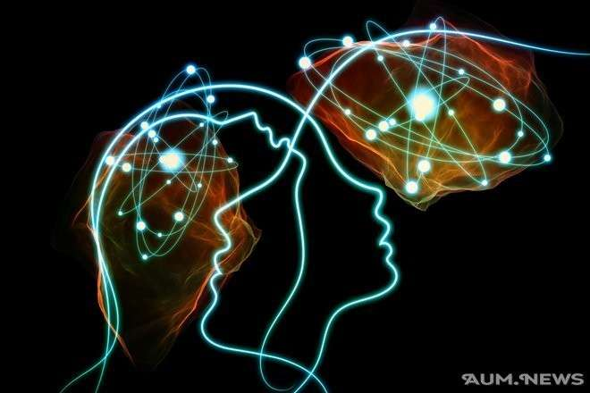
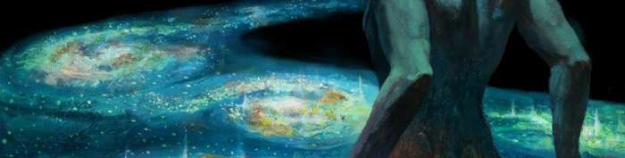

# Квантын физикийн онол ба бидний амьдрал жинхэнэдээ юу вэ?

Квантын физикийн ухаан, хүмүүсийн амьдралыг, тухайн хүн чухам юуг чухалчилан, юунд хамгийн их итгэж, юуг хүлээдгээс шалтгаалдаг гэсэн онол дэвшүүлж, Физикийн салбарын Нобелийн шагналт нэрт эрдэмтэд, бодит ертөнцийг, хамгийн бага хугацаа миллисекунд бүрт үүсч мөн сарнин, тасралтгүй лугшсаар байдаг энергийн далай тэнгис гэж нэрлэн Квантын физикийн үүднээс ертөнцийн онолыг эргэлзээгүйгээр нотолсоор байгаа юм. Хүмүүсийн бодол нь, энэхүү хувьсамтгай энергийн талбайд харж буй эд зүйлс, обьектууд болох бодит байдлыг үүсгэх цуглуулах, байршуулах, байлгах чадвартай гэдгийг тогтоожээ. Тэгвэл бид яагаад, бодит зүйлсийг мөн бие биенээ, анивчин буй энерги гэж харахгүй, биетээр хардаг юм бол гэсэн асуулт урган гарна. Энэ тохиолдолд, секундэд 24 кадрын давтамжтай кино зургийг жишээ болгон авч, хугацааны давтамжийн хурдын хүчээр хүний хараанд, тасралтгүй хөдөлгөөнт дүрслэл хуурмагаар үүсч байдаг, мөн зурагт радионы электрон-цацрагийн гуурсан дах асар олон электронууд дэлгэцийг мөргөх маягаар хэлбэр, хөдөлгөөнүүдийг дэлгэцэн дээр үүсгэн харуулж байдагтай харьцуулан тайлбарладаг байна. Үүний адил бүх эд зүйлс обьектууд, ямар ч тохиолдолд ийм маягаар оршидог гэж үздэг. Хүмүүсийн таван мэдрэхүй /харах, сонсох, үнэрлэх, амтлах, хүртэх/ бүр, тус бүр тодорхой хэмжээний хүлээн авах чадвартай. /Жишээ нь, нохойны сонсгол хүнийхээс өөр, могой өөр түвшинд хардаг гэх мэт/ Өөрөөр хэлвэл, хүн, өөрийн мэдрэхүйн түвшний тодорхой хязгаарлагдмал хүрээнд багтсан энергийг хүлээн авч өөрийн ертөнцийг үүсгэн дүрсэлдэг, мөн эдгээр нь бодит үнэн мөн дээр бус төрснөөс хойш төлөвшин тогтсон “дотоод зураглал” дээр үндэслэдэг гэж үзэж байна.

Тиймээс, бидний бодол энэхүү үл үзэгдэх энергитэй нягт холбоотойгоор энергийг хэлбэржүүлж, ертөнцийн хэсэг ширхэг бүрээс ялган сонгож бодит амьдарлаа үүсгэж байдаг. Эргэн тойрноо харагтун. Харж буй бүх зүйлс эхлээд санаа байсан, санаанууд хуваалцагдаж, илэрхийлэгдэж өссөөр хэсэг үе шатны дараа физик бие болдог, тиймээс, хүн юуг их бодож байна тэр зүйл нь бодит болон биежнэ. Юунд хамгийн их итгэнэ амьдрал нь мөн тийм л байна. Ертөнц бол тухайн үзэл бодлоо өөрчилөх хүртэл орших, үнэн мөнд тооцож, итгэн үнэмшиж буй зүйлсийн толь. Мөн бидэнд, хатуу бэрх, хувиршгүй мэт санагддаг амьдрал нь огт тийм зүйл биш, харин ч, байнга өөрчилөгдөх боломжтой, хувь хүн болоод олон нийтийн бодол, үзэл санаан дээр тогтдог зүйл бөгөөд хүмүүсийн үнэн мөнд тооцож буй зүйлс, хүн тус бүрийн итгэл үнэмшил бодлоос шалтгаалдаг зэрэглээ мэт зүйл гэж квантын физик тунхагладаг. Энэхүү нээлтүүдийн ачаар, бидний өмнөх зэрэглээн хөшиг нээгдэж эхлэн, мэдлэгийн хүрээгээ тэлж, бодлоо ашиглан амьдралын мөн чанарыг ухаарах, амьдарлаа өөрчилөх боломжууд нээгдэж байгаа нь гайхалтай... Бидний бие, цусны эргэлтийн систем, хоол боловсруулах систем, эндокрин систем, булчингийн систем, мэдрэлийн систем, нөхөн үржихүйн систем, амьсгалын систем, араг ясны систем, шээсний замын систем гэсэн есөн системээс бүрддэг. Эдгээр системүүд нь эд, эрхтэнээс, эд нь эсээс, эс молекулаас, молекул атомаас, атом субатомын хэсгүүдээс, субатомын хэсгүүд энергээс бүрддэг байна. Иймд, би, мөн та, бид бүгдээрээ оюун ухаант, хамгийн сайхан цэвэр гэрэлт энерги бөгөөд бидний амьдрал, агуу их оюуны маань хяналтан дор өнгөцхөн хувьсан байх энергийн тэнгис аж. Мөн асар хүчирхэг микроскоп доор бидний биеийг харвал, бид электрон, нейтрон, фотон зэргүүдээс бүрдсэн байнгын хувьсамтгай энергийн бөөгнөрөл гэдгээ олж харж, итгэх боломжтой гэнэ. Үүний адил эргэн тойрны маань эд юмс ч адил байдаг бөгөөд аливаа юмсыг ажиглах үеийн байдал, хүлээн авалтаас бүх зүйл хамааралтай байдаг аж. Ямар ч эд юмс ажиглалтаас ангид оршдоггүй байна. Тиймээс, бид юуг анзаарч, юуг ажиглан, юунд илүү анхаарч, юунд эрмэлзэж зорьж байгаагаас шалтгаалан амьдрал маань бүрддэг болохыг квантын физикийн ухаан, шинжлэх ухааны үндэслэлтэй тогтоожээ. Таны ертөнц бол, таны өөрийн тань давтагдашгүй, хэн ч нэвтэршгүй өвөрмөц оюун ухаан, амин сүнс, бие мах бодоос тань бүрдэж байдаг байна. Таны нүдээрээ харж буй, биеэрээ мэдэрч буй зүйлс таны бодит ертөнц буюу бие мах бод. Бие нь шалтгааны үр дагавар. Энэхүү шалтгаан нь Бодол санаа аж. Тиймээс, жинхэнэ, чин хүслээ биежүүлэх, бодит болгох, сайхан амьдрахын тулд, хорвоо ертөнц, амьдралыг өөрөөр харж сурах, аливааг сайнаар харах, муу бодол тээхгүй байх, бодолдоо эерэг хүлээлтийг үүсгэх хамгаас чухал байдаг байна.
