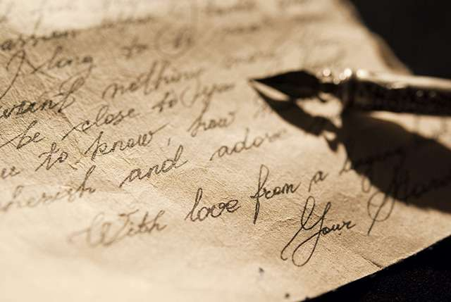

# Үл таних эрэгтэйн захидал

Би эрэгтэйчүүдийн талаар, мөн үргэлж хүчтэй, зоригтой гэж өөрсдийгөө тооцож ирсэн ч, ухаарлыг эрхэмлэдэг эрэгтэйчүүдийг олон байгаасай гэсэн дээ, нэгэн тохиолдлын тухай бичихээр шийдлээ. Нэг удаа би, эгч минь өрөөндөө уйлж суухтай таарав. Аав минь шалтгааныг нь мэдэхээр удаанаар ярилцан сууснаа, толгойг нь илээд эгчид минь хэлсэн –“Охин минь, чи дахиад хэзээ ч уйлахгүй амьдрах, нэгэн том эр хүнтэй тааралдна аа” гэсэн үгс насан туршид минь толгойд минь хадгалагдан, тэрхүү “том эр хүн” болохын тулд яах ёстой юм бол гэх асуулт өглөө бүр дотор минь эргэлдсээр найман жил өнгөрчээ. Энэ үгсээс эрч хүч ирэх шиг санагддаг. Он жилүүд өнгөрөн, нас нэмэгдэн ухаан суухын хирээр, энэ үгсийн утгыг ойлгон, эрэгтэйчүүд бид, эрч хүчээр дүүрэн, уужим агуу сэтгэлтэй, халуун дулаан зүрх сэтгэлтэй байхын төлөө тэмцэлддэгсэн бол хорвоо ертөнц тэс өөр байх байсан гэж боддог болсон. Би “том эр хүн” гэдэг нь бүх зүйлийг худалдан авах чадвартай, эргэн тойрныхны хүндлэл, бараг хайр дурлалыг ч худалдан авах чадалтай хүнийг хэлдэггүй гэдгийг ойлгож, аав минь эгчид хэлж байсан, -“Чи, зөвхөн өөрийнхөө тухай ярьдаг, чамд, анхаарал халамж тавьдаггүй, зөвхөн өөрийнхөө хүрсэн зүйлээ ярьж онгирдог, чамайг үгүйсгэдэг, алдаа дутагдлаас өөр зүйл чамаас олж хардаггүй, чамайг өөрийгөө өөрчилөхийг үргэлж шаарддаг хүнээс зайлсхийж зугтаж явах хэрэгтэй. Чамайг өөрчилөгдөхгүй бол тийм хүн, урваад явчих чадвартай, тэгээд ч чиний жинхэнэ дотоод гоо үзэсгэлэнг олж харж чадахгүй хүн тэнэг байдаг юм. Тийм эр нөхөр чамд хэрэгтэй гэж үү?” гэж хэлснийг санасаар яваа. “Том эр хүн” гэдэг нь, аливаа өндөрлөгт хүрсэн, их мөнгө, машин, байртай, олон сайхан бүсгүйчүүдээр хүрээлүүлсэн, царайлаг сайхан эр хүнийг хэлдэггүй, харин, цэвэр сэтгэлтэй, нуух хаах зүйлгүй, сэтгэл зүрхээ нээх сайхан чадвартай, бодит байдлаас зугтахгүй зоримог, эмэгтэйчүүдийн зан чанар, дотоод ертөнцийг үнэлж чаддаг, харцаа нуудаггүй, худлаа ярьдаггүй хүнийг хэлдэг болохыг ойлгож, тэрхүү “том эр хүн” болохыг чармайн явна. Харин эгчийн минь гэрлэлт, түүнд аз жаргалыг авчирсан. Нөхөр нь, “том эр хүн”. Тэр алдар нэртэй, албан тушаалын өндөрлөгт хүрсэн хүн биш, эд хөрөнгөтэй, амжилттай хүн биш. Гэхдээ, тэр, жинхэнэ эр хүн. Тэр эгчийг минь хэзээ ч уйлахад хүргээгүй, хүргэдэггүй. Эгч минь хамтын амьдралдаа хүрсэн бүх зүйлдээ сэтгэл хангалуун, “Том эр хүн” нөхөр нь, эгчид минь маш хайртай, эгчийг минь байгаад нь л баярладаг сайн эр хүн байдаг гэдгийг би, баяртайгаар бичиж байна. Бүх эрэгтэй хүмүүс “том эр хүн” шиг байцгааж, бүх эмэгтэйчүүд жаргалтай байгаасай...
