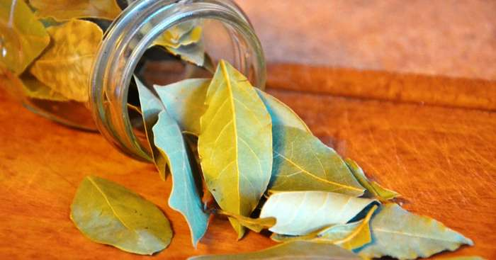

# Лаврын навчны ид шид

Айл гэр бүр, гэр орны өөрийн гэсэн үнэртэй байдаг. Зарим нь хэрэглэдэг үнэртэнг чинь шингээсэн байдаг, заримаас нь кофе, тухайн үед бэлтгэсэн хоол, мебель гэх мэт төрөл бүрийн үнэр ханхалж байдаг. Гэтэл зарим сууц, гайхмаар, цэвэр ариун гэмээр тансаг үнэртэй, тав тухыг мэдрүүлсэн, аядуу дулаан уур амьсгалыг цогцлоосон байдаг нь, эзэд нь, эртний грекчүүд, римчүүдийн хэрэглэдэг байсан аргыг мэддэг, хэрэглэдэгтэй холбоотой байж болох юм.

Эртний грек, римчүүд, лаврын навчийг зөвхөн хоолонд хэрэглээд зогсохгүй мөн орон гэрийн эвгүй үнэрээс салах, чийг дарах зэрэгт ашигладаг байжээ. Үүний тулд, лаврын навчийг шатаадаг байсан бөгөөд байнга ингэж хэрэглэх нь, зөвхөн үнэр дараад зогсохгүй зарим өвчнүүдийг эмчлэх, сэтгэл санаа өргөх зэрэг сайн талтайг мэддэг байж.

---

Өнөө үед, лаврын навчны үнэрийг, тайвшруулах, бие организмыг амраах , өвчин намдаах үйлчилгээтэй гэж нотлоод байгаа юм. Лаврын навчны үнэр, стресс, ядаргаа, нойргүйдлийн үед тустайгаас гадна унаж татдаг хүнд хэрэглэхэд үр дүн үзүүлж байсан байна. Энэ навч, цинеол, эфирийн тос агуулдаг, эдгээр нь амьсгалын замыг чөлөөлж, тайвшруулах, амраах үйлчилгээтэй байдаг аж. Та биеэ суллаж, амармаар байна уу? 10-хан минутын дараа үр дүнгээ үзүүлэх, 2 ширхэг хатаасан лаврын навч авч шатаагаарай. Та амрахаас гадна, өрөө тасалгаа тань шинэхэн агаараар анхилах болно.

Мөн, эрт дээр үеэс лаврын навчийг, ялалт, амжилт, цэвэр ариуны билэгдэл гэж үзэж ирсэн бөгөөд энэ ургамлыг ид шидтэйд тооцож, янз бүрийн зан үйлд хэрэглэдэг байжээ. Зарим улс оронд, одоо ч сахиус болгон хаалганыхаа дэргэд мөчрийг нь өлгөсөн байдаг.
