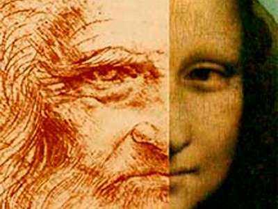

# “Лестерский кодекс” буюу Леонардо да Винчигийн өдрийн тэмдэглэл ба Билл Гейтс

Энэхүү өдрийн тэмдэглэл дэлхийн хамгийн үнэтэй тэмдэглэлийн дэвтэр бөгөөд 30 гаруй сая доллараар үнэлэгддэг. Яагаад, энэ тэмдэглэл ийм өндөр үнэтэй болон ямар учраас, энэ өдрийн тэмдэглэл Билл Гейтст хэрэг болов гэсэн олон асуулт хариултгүй хоцордог нь гайхалтай юм. Уг өдрийн тэмдэглэлийг, XYI зуунд, Леонардо да Винчи, Милан хотод амьдарч байхдаа хөтөлж байсан бөгөөд тэмдэглэлдээ, Леонардо да Винчи, хорвоо ертөнц нь хүний организмын адил, амьд организм юм, түүний бие нь газар дэлхий, цус нь ус, гол горхи, оюун санаа нь агаар салхи юм, түүнчилэн, сарыг яагаад бид зөвхөн шөнийн цагаар хардаг, гол мөрөн хаанаас, юунаас эхтэй, чулуу эрдэсүүдийн бүтэц зэргийг тайлбарласан гар зураг, схем, математик тооцоо, диаграммаар дүүрэн байдаг гэнэ. Мөн нижгээд хэсэг нь, алдарт бүтээл “Мона Лиза”-гаа хэрхэн зурсан талаараа тэмдэглэсэн байдаг бөгөөд Сод ухаантан, гарамгай сэтгэгч, түүний өндөр сэтгэхүйг ойлгоход бэрх бичээсүүдээр мөн дүүрэн байдаг аж. Мөн, уг гар бичмэлийг зөвхөн толинд тусган уншиж болдог. Яагаад, Леонардо да Винчийн тэмдэглэл атал “Лестерский кодекс” гэж нэрлэгдсэн юм бол, гэсэн асуултыг тавьж байгаа тань лавтай. 1717 онд энэ гар бичмэлийг гүн Лекстер анх олж авсан бөгөөд тэр, өөрийн нэрээр нэрлэжээ. Дараа нь, нефтийн магнат Хаммер худалдан авч, мөн Хаммерын кодекс гэж нэрлэжээ. Харин, 1994 онд, 30.8 сая доллараар Майкрософт-г үндэслэн байгуулагч Билл Гейтс, худалдан авсан ч, нэрийг нь өөрчилөөгүй, гэхдээ, дэлхийн томоохон музейнүүдэд, уг гар бичмэлээ үзмэр болгон тавиулдаг бөгөөд яагаад ч юм, өөрийгөө ”Зохиогч” гэсэн бичиг заавал дэргэд нь тавиулах нөхцөлтэйгээр гэрээ байгуулдаг байна. 2003 оноос Сиэтлийн музейд тавигдаад байгаа аж.

