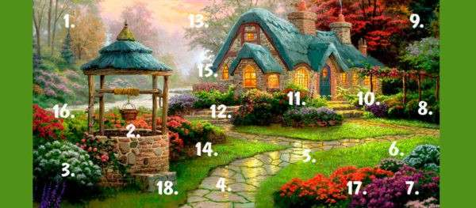

# Үлгэрийн ертөнцийн ид шидэт тоонуудаас сонгож, байр байдлаа шалга

Гайхамшгийн байшингийн ид шидийн тоонуудаас нэгийг нь зоригтой сонгон, хариултаа уншаарай. Удаан бодолгүй, хамгийн эхэлж харсан тоогоо зөн зовингоороо сонгоход илүү үнэн байдаг.

1. Дутагдлуудаа айхтар бодоод байлгүй, давуу сайн талуудаа илүүтэй бод\
2. Хувь тавиландаа найдаж болно\
3. Бүх зүйлийг гартаа авах хэрэгтэй байна\
4. Гэртээ битгий хоргодоод бай. Эргэн тойронд өчнөөн сонирхолтой зүйлс өрнөж байна. Судалж шинжлээд бусадтайгаа хуваалцаач\
5. Хөндлөнгөөс ямар харагдаж байгаадаа битгий санаа зов. Биеэ суллаж уртаар амьсгаа аваад баярлахад бэлд\
6. Байгаа бүхэндээ баярлаж сур. Таларх\
7. Битгий тэвч. Хөдөл. Үг худал, үйлдэл үнэн шүү. Үг хоосон байна энэ тохиолдолд\
8. Өөрийгөө, бие мах бодоо хайрла. Биеэ баярлуулан, хөөстэй, давстай, үнэртэнтэй онгоцонд сууж алжаалаа тайлах боломжийг ашигла\
9. Цаг хугацааг үнэл. Дэмий бүү үр. Үр ашигтай өнгөрүүлсэн цаг хором өгөөжөө хэзээд өгдөг\
10. Хүмүүсийг үнэлж хүндэл. Хуучин сайн танилууддаа утасдаж болох юм\
11. Ид шид, гайхамшигт итгэ. Гайхамшиг, түүнд итгэдэг хүмүүст үргэлж тохиолдож байдаг\
12. Хүмүүст итгэж найдсанаар гайхмаар зүйл хүлээж байна\
13. Аз жаргал дэргэд чинь байна\
14. Санаа зовж буй зүйлээ чин сэтгэлээсээ хуваалцсан нь дээр\
15. Үзээд алд. Үр дүн нь сайн\
16. Ид шидийн гайхамшиг гэнэт ирдэг\
17. Хэн нэгэн, танд дурлачихаж\
18. Байр байдлаа зөнгөөр нь орхичих. Өөрөө шийдэгднэ\
Ид шидтэний гайхамшгийн байшин, гэрийнх нь орчиноор ороод гарлаа санаа сэтгэл ямар байна? Гайхамшгийн ойгоор аялах хүсэл байна уу?
