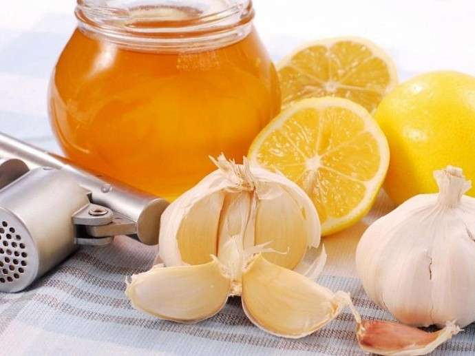

# Лимон, 7 өвчний “эрлэг”

Лимон нь хүний амьдралд хамгийн хэрэгцээтэй жимсгэнэ юм. Маш олон төрлийн амин дэм агуулдаг бөгөөд олон өвчнийг анагаах чадвартай олон үйлчлэлийг нэг дор агуулдагаараа гайхагддаг аж.

Ангина. Хоолой өвдсөн үед тал лимоныг хальстай иддэг. Хэдийгээр хүчтэй исгэлэн гашуун ч гэсэн ашигтай талаас нь бодож хэрэглэх хэрэгтэй. Мөн, лимоны шүүсийг 1:3 харьцаагаар устай найруулан цаг тутам хоолойгоо зайлдаг. Лимоны шүүсээр хоолойны идээ татсан газарт, чих цэвэрлэдэг мод ашиглан түрхэж өгдөг.\
Бронхит. 5 ширхэг лимоныг хальстай нь ногооны үрүүлээр жижиглэн, 4 хумс сармис мөн жижиглэн хольж 1 литр бүлээн усаар найруулаад сайтар таглан 5 хоног харанхуй сэрүүн газар тавьж бэлтгэнэ. Үүнийгээ өдөрт 3 удаа хоолноос өмнө хэрэглэнэ.\
Дотор муухай оргих үед. Тал лимоны шүүсийг шахаж ууна.\
Ханиад. Өөр бусад ургамлуудтай хольж хандлан цайны оронд уудаг.\
Атесклероз. 1 хоолны халбага нарсны шилмүүсэн дээр 1 стакан буцламгай ус хийнэ. Шүүж, тал хальсгүй лимон хийж, уг ахндаа 3 хувааж, өдөрт хооллохоос 1 цагийн өмнө ууж хэрэглэнэ.\
Шар өвчин. Энэ өвчины үед, лимонтой ус хэрэглэх үр дүнтэй байдаг. 1 лимоныг хальснаас нь цэвэрлэж, буцламгай ус хийж 12 цаг тавиад уух\
Даралт багасах. 5-6 лимоныг махны машинаар машиндан, 100 грам баданы /аптект байдаг/ навчтай хольж, 1 литр хүйтэн ус нэмж 36 цаг хөргөгчинд тавьна. Үүн дээрээ, 0.5 кг зөгийн бал нэмж дахин 25 цаг хөргөгчинд байлгаад бэлэн болно. өдөрт 3 удаа, хоолны өмнө 1/4 стаканаар хэрэглэнэ. Нэг курс гурван долоо хоног.
