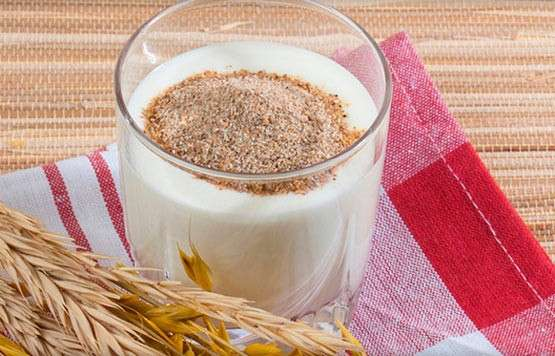
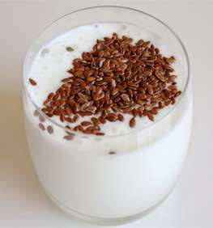

# Маалингын үр ба организмын “их цэвэрлэгээ”

Гэдсэнд хуралдсан салст, чулуужсан өтгөн, паразитуудыг маалингын үр устгадаг бөгөөд олон өвчнөөс салах хялбар арга гэж үздэг. Хүн, 70 жил амьдрахад, хүний гэдсээр100 тонн хоол хүнс, 40 мянган литр шингэн дамжин гадагшилдаг гэж үздэг. Үүний үрээр гэдсэнд 15 килограмм хортой ялгадсын чулуужсан өтгөн, бие организмыг хордуулан, цусыг бохирдуулан байж байдаг байна. Архаг өтгөн хаталт, бодисын солилцооны өөрчлөлт, чихрийн шижин, харшилууд, илүүдэл жин эсвэл тураал, элэг бөөрний өвчлөлүүд, хараа, сонсголын өвчнүүд, арьс, үс хумсны эрүүл бус байдал, системийн өвчлөлүүд болох артрит, хорт хавдар зэрэг нь гэдэсний бохирдолттой холбоотой гэж үздэг. Гэдсийг бургуй, мөн тусгай төхөөрөмжөөр цэвэрлэх аргууд байдаг ч маалингын үр, маалингын гурилаар цэвэрлэх аргыг, гэдэсний микрофлорыг хадгалсан хамгийн хялбар, сайн үр дүнтэй арга гэж үздэг. Биеэс хор, шлакыг гадагшлуулан, цусан дах холестериныг бууруулан, нян, паразит, гельминт, мөөгөнцрийг устгадаг. Маалингын үр, гурилыг хэрэглэснээр:

-дээд амьсгалын замын салст бүрхэвчийн үрэвсэл\
-ходоод-гэдэсний замын үрэвслүүд\
-гастрит, колит\
-ходоод, арван хоёр нугалмай гэдэсний шархлаа\
-шээсний замын өвчлөлүүд, пиелит, цистит\
-илүүдэл жин\
-липидийн солилцоо муудах зэрэг өвчлөлүүдийг эмчилнэ. Мөн урьдчилан сэргийлэх зорилгоор өдөр тутам хэрэглэхийг зөвлөдөг.\
Гэдэс цэвэрлэх арга:\
Эхний долоо хонот: 1 десертийн халбага /цайны халбагаас жижиг/ маалингын гурилыг 100 грам тараг\
Хоёр дох долоо хоногт: 2 десертийн халбага, 100 грам тараг\
Гуравдах долоо хоногт: 3 десертийн халбага, 150 грам тараг.\
Өглөөд хэрэглэдэг. Мөн маалингын үрийг 1 цайны халбагыг өглөө бүр, бүлээн усаар даруулж иднэ. Аль ч аргыг хэрэглэх үедээ, 2 литрээс багагүй ус уух хэрэгтэй байдаг.
