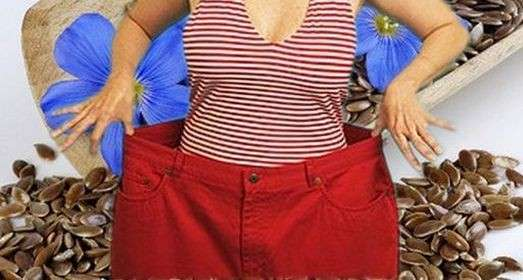
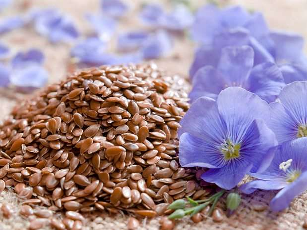

# Маалингын үрний ашиг тус

Маалингын үрийг хүмүүс эрт дээр үеэс хэрэглэж ирсэн, эмчилгээ болон гоо сайханд нөлөөлөх ашиг тус нь батлагдсан ургамал ажээ. Орчин үеийн судалгаагаар, маалингын үр, маалингын үрийн тос нь, өөр бусад ургамлын найрлагад маш ховор таардаг, омега- 3 тосны хүчлийн агууламж нь маш их гэдгээрээ гайхагдаж байгаа юм.

Маалингын үрийн тосны ашигт чанар агаартай маш хурдан исэлддэг учраас маалингын үрийг хэрэглэх нь илүү үр дүнтэй гэх нь бий. Энэ үрний эмчилгээний ашигтай чанар, биед хамгийн ашигтай тосны хүчил омега-3, эслэг чанар, фитоэстрогены агууламжид оршдог бөгөөд, мөн А,Е аминдэмүүд, В-н группын аминдэмүүд, маш ховор F амин дэм, кали, кальци, магни, йод, цинк, төмөр, каротин, фосфор, кремний, никель, марганц, болон бусад олон элементүүдийг агуулдагаараа онцлог юм.\
Маалингын үрэн дэх фитоэстроген, эмэгтэй хүний даавартай ижил шинж чанартай бөгөөд эмэгтэй хүний гоо сайхны бүх асуудлуудыг /арьс, үс, хумс/, шийдэх, “эмэгтэй хүнийг эмэгтэйлэг” байлгах эмэгтэй хүний дааврыг тохируулж өгдөг чадвартай аж. Гоо үзэсгэлэнт Клеопатра хатан хааны үзэсгэлэнг энэхүү маалингын үртэй холбосон домог хүртэл байдаг байна. Хоолны дуршлыг бууруулж, хэрэглэсний дараа ходоодонд хөөж цатгалдуулдаг чанараараа илүүдэл жинтэй хүмүүст хамгийн ашигтай хувилбар юм. Мөн биеэс хор гадагшлуулах ба хоол боловсруулах эрхтэний үйл ажиллагааг сайжруулж, эм тариа шиг, гэдэсний бичил орчиндох эрүүл чанарыг бууруулдаггүйгээс гадна гэдэсний хананд хамгаалалтын бүрхэвч үүсгэдэг байна. Тархины үйл ажиллагааг сайжруулж, зүрх судасны системийг бэхжүүлдэг нь түүний омега-3 –ын өндөр агууламжтай холбоотой. Энэ үрийг хэрэглэж байх нь зүр судасны өвчлөлөөс бүрэн сэргийлдэг. Мөөгөнцөр, бактерийн эсрэг өндөр үр дүнтэй лигнан, омега-6, омега-3 –ын агууламж нь бие организмыг хорт хавдараас хамгаалдаг. Маалингын үрийн хандаар үе мөчний бүх төрлийн өвчнүүдийг эмчилдэг. Илүүдэл холестериныг хөөх үйлчилгээтэй аж. 

#### Хэрэглэх аргууд:

-Ханиад болон хоолой, буйл үрэвссэн үед, маалингын 2 цайны халбага үрэн дээр халуун ус хийж сайтар сэгсрээд, 1 цаг орчим тавьж дарах маягаар бэлтгэн шүүгээд хэрэглэнэ.\
-Өвчин намдаахад, атга хирийн маалингын үрийг бутлаад, самбайнд боож, 10 минут халуун усанд байлгаад өвчтэй хэсэг дээр жин маягаар тавьна. \
-Зүрх судасны өвчинд, 2 хоолны халбага маалингын үрийг бутлагчид бутлаад, 200 грамм халуун ус хийж 10 минут тавиад, уух. \
-Дархлаа өсгөхөд. Маалингын үрийн тосыг хоолондоо нэмж хэрэглэнэ. /хүүхдэд 1-2 цайны халбага, том хүн 1-2 хоолны халбага/ \
-Бөөр давсаг цэвэрлэхэд, 1 хоолны халбага үрэн дээр 200мл халуун ус хийж халуун саванд хонуулж өглөө нь 1 стакан халуун ус хийж шингэлэн өдрийн турш 3 тасалж ууна. \
-Үе мөч, подагра. 2 ц.халбага үрийг 500мл усанд 15 минут буцалгаад, 10минут тавиад, шилэн саванд юүлэн 5 минут орчим сэгсрээд шүүж, өдрийн турш 4-5 удаа ууна. \
-Гайморит. 2 хоолны халбага үрийг 0.5 литр усанд зөөлөн гал дээр чанаад, уураар нь 10 минут утах. \
Чихрийн шижин. 1-3 цайны халбага үрэн дээр хүйтэн ус /буцалсан эсвэл цэвэр ус/ хийж 2-3 цаг байсгээд хутгах маягаар тавьж унтахын өмнө уух. \
-Үсний хаг, толгой хогжруутахад маалингын үрийн тосыг үл ялиг халааж үсний уганд түрхээд 15 минутын дараа угаадаг. \
-Эмчилгээний нүүрний маска. 2 цайны халбага үрэн дээр, 100мл халуун ус хийж 1 цаг орчим тавьж дараад, нүүрэндээ түрхэж 20-30 минут болгоод угаадаг. \
-Илүүдэл жингээс салах буюу турахад, тураах зориулалттай бүх эм ба эмийн бус бүтээгдэхүүний гол чанар нь эслэг ихтэй орц найрлагатай байхаас шалтгаалдаг. Энэ чанар нь маалингын үрэнд их байхаас гадна ходоодонд хөөж, доторх бүх хэрэггүй ашиггүй зүйлсийг хамж гадагшлуулдаг. 1 хоолны халбага маалингын үрэн дээр 200 мл халуун ус хийж 20-30 минут чанаж хандлан хөргөөд, хооллохоос 15-20 минутын өмнө хэрэглэнэ. \
Эсвэл, 1 хоолны халбага маалингын үрэн дээр 1 стакан буцалсан ус хийж шөнийн турш байлгах буюу дарах маягаар бэлтгэж хоолны өмнө хэрэглэнэ. \
Мөн 1 хоолны халбага маалингын үрийг буталж 1 стакан тарагтай хутгаж, өглөөний цайны өмнө уудаг. \
Маалингын үрийг, ямар ч ашигтай зүйлсийг хэтрүүлэхэд хор болдогийн адил, өдөрт 1халбагаас илүү хэрэглэж болдоггүй. Эмчилгээний зориулалтаар 5-50 грамм хэрэглэдэг. Түрүү булчирхайн хавдар, гэдэсний үрэвсэлт өвчнүүд, бөөр цөсний чулуутай өвчтөнүүд хэрэглэж хэрэггүй. Мөн архаг өвчтэй, тогтмол эм хэрэглэдэг хүмүүс эмчтэй зөвлөж хэрэглэх хэрэгтэй. Эмийн шимэгдэх чадварыг бууруулдаг. Мөн жирэмсэн эмэгтэйчүүд хэрэглэхийг зөвлөдөггүй.
