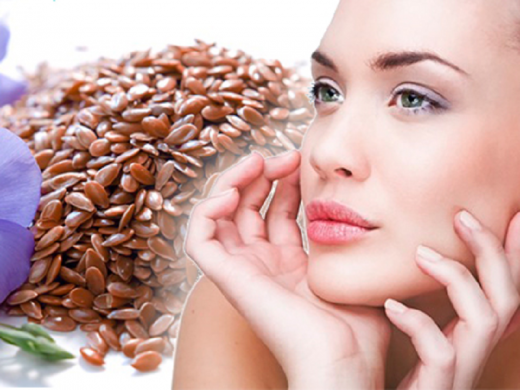

# Маалингын үрний маска ботоксыг орлоно

Маалингын тос нь, чөлөөт радикал болон холестериныг устгадаг чанартай гэдгийг бүгд мэддэг. Харин энэхүү тосыг гаргаж авдаг, маалингын үр нь, нүүр хүзүүний арьсанд, хамгийн сүүлийн үеийн гоо сайхны бүтээгдэхүүнтэй эн тэнцэх үйлчилгээтэй гэдгийг тэр бүр мэддэггүй. Энэ маскыг орой бүр 10 удаа хэрэглэхэд, арьс толийж өнгөлөг болох гайхалтай үр дүнтэй бөгөөд бэлтгэж хэрэглэхэд хялбар давуу талтай юм.

Өглөө нь орой тавих маскаа бэлддэг. 1 цайны халбага маалингын үрийг 1/3 стакан буцалсан халуун усанд хийж 1-2 минут сайтар хутгаад, таглаж тавин, орой хэрэглэнэ. Орой нь нүүрээ цэвэрлээд, хэвтээ байрлалд, гоо сайхны хөвөнг, хандалсан маалингын үрэндээ дүрж нүүр хүзүүндээ түрхэн бага зэрэг сэвэрмэгц дахин түрхэх маягаар 6 удаа түрхээд хатмагц бүлээн буцалсан усаар угаана. Үр дүн нь, өндөр үнэтэй хийгддэг гоо сайхны үйлчилгээнүүд, ботокстой дүйцэхүйц байдаг.
