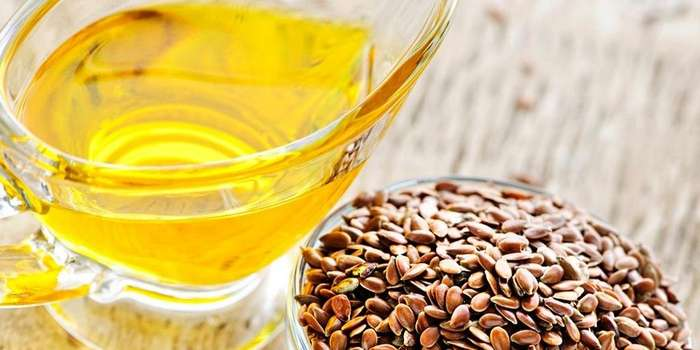

# Маалингын тос залуу насыг хадгалах үйлчилгээтэй.

Залуу нас гэж юу вэ? Энэ бол эрүүл бие, сайн судас, эрүүл мэдрэлийн эд эс, сайхан арьс, үс, бие галбир, гоо үзэсгэлэн юм. Хүний биологийн насжилт хэдийгээр зогсолтгүй явагдаж байх боловч, хөгшрөлтийг хойшлуулж, залуу насыг уртасгаж болно гэж үздэг. Энэ нь, өөрийгөө залуу сайхнаараа өтөл насандаа авч үлдэж, идэвхитэй амьдралаар амьдарч яваа хүмүүсийн төрх, байдлаар батлагдаж байдаг. Хүн төрлөхтөн, хөгшрөлттэй тэмцэх, урьдчилан сэргийлэх маш олон судалгаа, туршилт шинжилгээ хийсээр ирсэн бөгөөд одоо ч мөн зогсолтгүй явуулж байдаг.

Үүнээс, Оросын ард түмний дунд, олныг хамруулсан хамгийн сүүлийн судалгаагаар, залуу насыг хадгалахад хамгийн үр дүнтэй, ашигтай бүтээгдэхүүнээр маалингын тос шалгарсан байна. Маалинга нь өөр бусад ургамалд бараг байдаггүй Омега-3-р хамгийн баялаг, мөн омега-6, омега-9, Е аминдэм зэрэг хүний организмд хамгийн хэрэгцээтэй элементүүд агуулдаг ургамал юм. 100 грам маалингын тосонд 52 грам омега-3 ханаагүй тосны хүчил байдаг нь хамгийн өндөр агууламжид тооцогддог. Өдөрт 2 грам маалингын тос хэрэглэхэд хоногийн хэрэглээ омега-3 –аа хүн хангалттай авдаг байна. Омега-3 нь, тархи хөгшрүүлдэггүй, мөн зүрхний шигдээс, тархины цус харвалт, алцгеймерийн өвчнөөс сэргийлэх хамгийн хүчтэй тосны ханаагүй хүчил юм. Калифорнийн их сургуулийн судлаачдын 1500-д, дундач нас нь, 67-той хүмүүсийн дунд явуулсан судалгаагаар, омега-3-ын агууламжтай хүнс, бүтээгдэхүүн тогтмол хэрэглэдэг хүмүүсийн тархины томограф зурагны хариу, тархины хэмжээ нь, омега-3 хэрэглэдэггүй хүмүүсийнхээс харьцангуй том, мөн ой тогтоолт, хариу үйлдлийн чадвар, тархины үйл ажиллагааны чадвар маш сайн, түүнчлэн цусан дах хүчил төрөгчийн хэмжээ илүү өндөр байгаа нь тогтоогджээ. Мөн, маалингын агууламж дах ¬ Е амин дэм мэдрэлийн эд эсийг хамгаалдаг. Маалингын тосыг харанхуй, тасалгааны температурт хадгална. Хэрэглэхдээ, өдөрт ¼ цайны халбагыг цэврээр нь уух хамгийн үр дүнтэй бөгөөд өдрийн хангалттай хэрэглээ болох омега-3, Е амин дэмээ авахаас гадна, эрүүл мэнд, залуу насаа хадгалахад зүйрлэшгүй тустай бүтээгдэхүүнээр шалгарчээ. 100 грам маалингын тос нь нэг хүний 50 өдрийн хэрэглээ болдог. Мөн салат зууш амталж гэр бүлээрээ эрүүлжих бололцоо олгодог сайн талтай юм.
