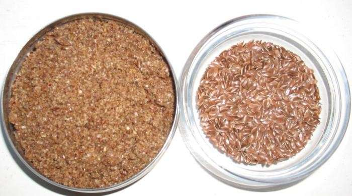
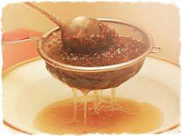

# Маалингын ундааны ашиг тус

Маалингын үр эрүүлжүүлэх өндөр үйлчилгээтэй ургамал юм. Эртний оросод, уг үрийг бутлан гурил болгон, түүгээрээ, заримын тань мэдэх кисель ундааг бэлтгэж, олон өвчний үед хэрэглэж, уудаг байжээ.

Эхний үед энэ ундаа, нялцгайдуу мэдрэмж төрүүлж таагүй мэт санагддаг. Гэхдээ, бие организмын эерэг өөрчлөлтүүд, хоол боловсруулах эрхтэнүүдийн үйл ажиллагааны сайжралт, хоолны дуршил бууруулах, нийт бие организмыг эрүүлжихэд өндөр үр дүнтэй. Энэ ундааг, амттай болгох үүднээс жимс, цикори нэмж хэрэглэж болдог. Мөн маалингын гурилыг тараг, йогуртад шууд нэмж хэрэглэх нь бие организмд ямар ч сөрөг нөлөөгүй, олон ашиг тустай байдаг. Маалинга нь өөрөө, ус, шингэн зүйлтэй харьцах үедээ, цэлцгэнүүр маягтай болох шинж чанартай байдаг, энэ чанар нь, ходоод гэдэсний салст бүрхэвчийн үрэвсэл, шархлааг эмчлэх давуу тал болдог. Мөн, үүний зэрэгцээ биеэс хор гадагшлуулж, биеийг цэвэрлэн, дархлааг өсгөн, эслэг ихтэй учраас, ходоодонд хөөж цатгалдах мэдрэмж өгдөгөөс илүүдэл жинг эрүүлээр хасахад гайхалтай нөлөөлдөг бөгөөд өтгөн хаталт арилж, хаван хөөгдөж, бие цэвэрлэгдсэнээр, бодисын солилцоо сайжирч, элэгний үйл ажиллагаа сэргэдэг байна. Арьсны өвчинүүд, элэг, бамбайн булчирхайг эмчлэх, судас цэвэрлэх, даралт бууруулах, зүрхний шигдээс, цус харвалтаас сэргийлэх үр дүнтэй үйлчилгээтэй байдаг бөгөөд омега-3 –н өндөр агууламж нь тархины үйл ажиллагааг дэмждэг. **Ходоод гэдэсний үрэвсэлт өвчины үед:** -Үрийг буцалсан усанд дарж, эсвэл гурилыг буцалсан усанд хутган уух маягаар хэрэглэдэг. 1 хоолны халбага үрийг халуун саванд хийж буцалсан ус 2 стаканыг нэмж таглан, өглөө нь хэрэглэнэ. **Бие цэвэрлэх:** 1/. 1 хоолны халбага үрэн дээр хагас литр буцалсан ус хийж, 2 цаг буцалж буй устай саванд байлгаж хандлана. 2/. 2 хоолны халбага үрийг 1 стакан устай халуун саванд хонуулж, өглөө нь 1 халбага маалингын гурил нэмж хутгаад, хоолноос 30-д минутын өмнө хэрэглэх. Хүчтэй үйлчилгээтэй тул ходоод гэдэсний архаг өвчтэй хүмүүс үүнийг хэрэглэж болохгүй. **Жин хасахад:** 1.5 хоолны халбага гурилыг хагас литр бүлээн усанд хутгаад, гал дээр тавьж буцалмагц авч хөргөөд хоолны өмнө тал стаканаар ууна. Хөргөгчид хадгалж болохгүй. Эдгээрийг хэрэгэлэх үедээ, ус ахиухан ууж байх хэрэгтэй. 10 хоног уугаад, 10 хоног завсарлах нь үр дүнтэй. 3-4 курс хэрэглэсний дараа үр дүн гардаг.
