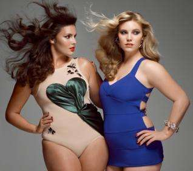

# Махлаг эмэгтэйчүүдтэй ханилсан эрэгтэйчүүд, аз жаргалтай, мөн илүү урт насалдаг

Аргентины Шинжлэх Ухааны Академын, доктор Филемин Альварадо, Эдгардо Моралес нарын урт настай, мөн аз жаргалтайд өөрсдийгөө тооцдог эрчүүдийн дунд явуулсан судалгаагаар, тэдний ихэнхи нь, махлаг “памбагар” эхнэрүүдтэй болох нь тогтоогджээ. Тэд, туранхай хатагтай нартай амьдардаг эрчүүдтэй харьцуулахад хавьгүй эрүүл, амьдралын баяр баясгалантай, 10 дахин илүү аз жаргалтай байдаг байна. Судлаачид, аз жаргалтай хүн урт наслах нь тодорхой юм гээд, махлаг эмэгтэйчүүд эр нөхрийнхөө сэтгэл санааны байдлыг илүү мэдэрдэг, мөн ор дэрэндээ сайн байдаг, мэдрэмтгий, уян хатан зантай, өөрийгөө хэтрүүлэн үнэлдэг зан чанаргүй байдаг зэрэгтэй нь холбоотой болох нь мөн, энэ судалгаагаар илэрлээ гэжээ. Тиймээс, хэдэн килийн илүүдэл жин нь, өөх тарга биш, харин хайр халамж, энхрийлэл байдаг байх нь ээ.
