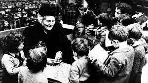

# Мари Монтессори-н эцэг эхчүүдэд өгсөн зөвлөгөө

Итали эмэгтэй Мария Монтессори, улсынхаа тэр үеийн анхны эмэгтэй эмч болж байсан бөгөөд өөрийнхөө бүхий л амьдралыг хүүхэдтэй ажиллахад зориулж, хүүхдийг тал бүрээр хөгжүүлэх гайхамшигтай системийг бүтээж, 20-р зууны сурган хүмүүжүүлэх ухаанд хувьсгалын хэмжээний үнэт хувь нэмэр оруулсан хүн юм. Мөн хүүхдийн хүмүүжлийн товч дүрэм зохиосныг танилцуулъя. Эдгээр дүрмийг мөрдөх нь хүүхдээ хүмүүжүүлэх, хөгжүүлэх, зөв өсгөхөд нэн тустай нь маргаангүй юм.

-хүүхэд эргэн тойронд байгаа хүмүүсээс аливаад суралцдаг\
-хүүхдийг байнга шүүмжлээд байвал, бусдыг буруутгадаг, шүүмжлэмтгий болдог\
-магтаал, аливааг үнэлж чаддаг болгоно\
-дайсагнасан харьцаа, хүүхдийг зодоон цохионоор аливааг шийддэг болгоно\
-шударга зөв харьцаа, ёс зүйтэй хүн болгоно\
-байнга хүүхдийг шоолж инээх нь, ичимхий бүрэг болгодог\
-аюул эрсдэл мэдэхгүй өсч буй хүүхэд итгэлд суралцсан байдаг\
-алдаа оноог нь хэт шүүмжилж шившиглэх нь хүүхдийг өөрийгөө буруутгах үзэлтэй болгодог\
-байнга урам өгөхөд, хүүхэд өөрийгөө үнэлэх чадвартай болдог\
-хүлээцтэй харьцаа хүүхдийг тэвчээртэй болгоно\
-дэмжлэг, хүүхдийг өөртөө итгэлтэй болоход сургадаг\
-эвтэй найртай орчинд, өөрийгөө хэрэгтэй хүн гэж мэдэрч өсч буй хүүхэд хайр энэрэлээр дүүрэн хүн болдог\
-хүүхдийнхээ тухай хэзээ ч муу юм бүү ярь\
-хүүэддээ сайн чанарууд төлөвшүүлэхэд бүх анхаарлаа зориул\
-хүүхдээ хандахад, сонсч хариулж бай\
-хүүхдийнхээ алдааг ойлгож, засахад нь тусалж бай\
-хүүхэддээ хүндэтгэлтэй хандаж сур\
-хүүхэддээ туслахад байнга бэлэн байж сураарай\
-хүүхдийнхээ танин мэдэх үйл явцыг дэмжихийн тулд, халамж хайр, тэвчээрээр дүүрэн орчинг бүрдүүл\
-хүүхэдтэйгээ хамгийн сайхнаар харьцах хэрэгтэй\
Сайн хүүхэдтэй байхын тулд, сайн эцэг эх байх хэрэгтэй гэдгийг мартаж болохгүй.
