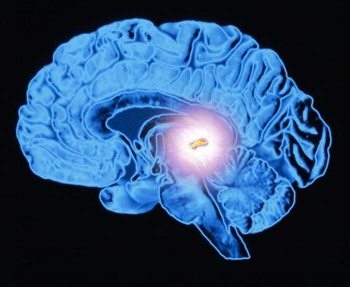

# Мелатонин-урт наслалтын даавар

Мелатониныг нойрны даавар, амьдрал, урт наслалтын даавар гэж нэрлэдэг. Энэ даавар хүн унтаж байх үед бий болдог бөгөөд бие организмд сайн нөлөөлөөд зогсохгүй, хүний, үйл хөдлөл, хэвийн үйл ажиллагааг хангахад туйлаас шаардлагатай байдаг нь нотлогдоод байгаа юм.

Уг дааврыг организм өөрөө үүсгэдэг, мөн зарим хүнсэнд агуулагддаг бөгөөд зориулалтын эм, нэмэлт бүтээгдэхүүнүүд мөн байдаг байна. Мелатониныг, эпифиз буюу самар булчирхай ялгаруулдаг. Нарны гэрлийн үйлчлэлийн нөлөөгөөр амин хүчил триптофан, серотониныг үүсгэх бөгөөд энэ нь шөнө мелатонин болон хувирч, нугасны шингэнд орж улмаар цусанд очдог. Тиймээс, энэхүү үйлчлэлийг организмд явагдуулахын тулд, хагас цагаас нэг цаг нарны гэрэлд, гадаа гарч байх хэрэгтэй байдаг. Мелатонины 70% -нь, шөнө ялгардаг бөгөөд харанхуйд илүү сайн ялгардаг байна. Идэвхитэй ялгарах хугацаа нь, оройн 8 цагаас эхлэн үүрийн 4 цаг хүртэл явагддаг бөгөөд энэ үед унтаж амрах нь, энэхүү даавраа өсгөх боломж гэж үздэг. Энэхүү боломжоо ашиглахын тулд, орой 12 цагаас өмнө унтах, 12 цагаас хойш ажиллах шаардлагатай бол, бүдэг гэрэл ашиглах, нойр дутуу байхгүй байх, унтахдаа ямар ч гэрэлгүй харанхуй нөхцөлд унтаж занших, боломжгүй үед нойрны нүдний хар маска хэрэглэх, шөнө босох тохиолдолд ердийн гэрлийн оронд бүдэг шөнийн гэрэл ашиглаж байх хэрэгтэй байдаг. Энэ даавар, хөгшрөлтийг удаашруулах, тунгалгийн булчирхайн идэвхитэй ажиллагааг хангах, бусад даавруудын ялгаралтыг дэмжих, тархины эд эсийг сэргээх, зүрх судасны системийн үйл ажиллагааг сайжруулах, харвалтаас сэргийлэх, дархлааг тэтгэх зэрэг бие организмын эрүүл байхад маш чухал үүрэг гүйцэтгэдэг. Их унтаснаар, мелатонин их ялгарна гэж ойлгож болохгүйг сануулах нь зүйтэй. Мөн, “Эрт унтаж, эрт бос” гэсэн ардын зүйр үг, урдны хүмүүс энэ бүхнийг мэддэг байсан мэт байдаг нь гайхалтай юм. Мелатонин даавар нь, архи, тамхи, кофеин хэрэглэх үед ялгарахаа больдог ба нас нэмэгдэхийн хирээр ялгаралт нь багасдагаас хижээл насныхан нойргүй болох байдалд орж байдаг аж. Мелатонин агуулдаг хүнсүүд: хулуу, хушга, бүйлс, гүнжидийн үр, бяслаг, өөхгүй мах, өндөг, сүү, гадил жимс, чангаанз, наран цэцгийн самар, улаан амтат чинжүү, байцаа, овъёос.
