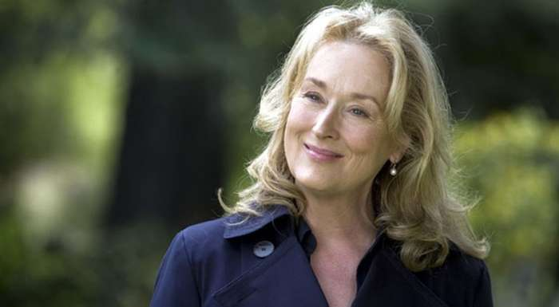
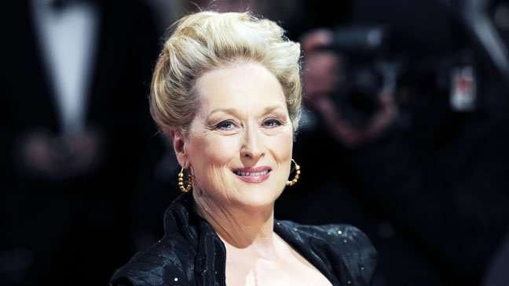

# Мерил Стрипийн хэлсэн, сэтгэлд хоногшим үгс

Энгийн, сайхан эерэг дүрийг ихэвчилэн бүтээдэг, америкийн нэрт жүжигчин Мерил Стрипийг харахад, бүтээсэн дүрээрээ ч тэр, ердийн байгаа байдал нь ч тэр, нэг л энгийн, ухаалаг, өрөөрөө байж чаддаг эмэгтэй мэт харагддаг, гэтэл, жүжигчин эмэгтэй маань, өнөөдрийн насныхаа өндөрлөг дээрээс, өнөөдөр бүхнийг өөрчилж, өөрөөрөө байж сурахаар тэмцэж яваа нь сонирхолтой. Тэрээр, хүн заавал аль бүхнийг үзэж, насны эрхээр ухаарахын оронд, эртнээс, мэдэж авснаар амьдрал байр байдлаа хөнгөвчилж болох юм, гээд дараах зүйлийг бичжээ.

Би, олон зүйлийг амьдралынхаа туршид тэвчиж явсанаа болихоор шийдсэн. Би, өнөөдөр, тэсвэртэй болсон эсвэл ихэрхүү болсондоо биш. Учир нь надад, амьдралын тодорхой нэг үе ирсэнийг, мөн миний насны хүн бүрт адилхан, энэ зүйл тохиолддог ч түүнийгээ анзаардаггүй, бусдад захиас болгохоор зүйл гэж үздэггүй болохыг мэдсэндээ, үүнийг бичиж байна. Амьдралын энэ үедээ, хүн, таалагдахгүй, өдөөн хатгасан, таагүй, сэтгэл өвтгөх олон зүйлийг анхаарч, бухимдан шаналахаас, цаг хугацаагаа харамладаг болдог юм байна. Би, төрөл бүрийн увайгүй хандлага, хэтэрсэн шүүмжилэл, хатуу шаардлагуудыг тэвчихгүй гэж өөртөө андгайлсан. Би, намайг таалдаггүй, дургүй хүнд таатай зүйл хийж саймширах, мөн дургүй хүндээ, инээмсэглэлийн минь хариуд инээмсэглэхгүй хүнд худлаа инээмсэглэхээ больсон. Би, хуурамч, худал ярьдаг, намайг ашиг сонирхолын үүднээс хардаг хүнд цаг заваа зарцуулахаа больсон. Би, дүр эсгэсэн, хуурамч магтаалыг жинхэнэ сэтгэлээс ялгадаг болсон. Би, боловсрол гэгээрэл ярьсан хуурмаг хүмүүсээс илүү, жинхэнэ хүнийг үнэлдэг болсон. Би, хов живээс салангад байхыг хичээж, хэрүүл маргаан, аливааг харьцуулахаас зайлсхийдэг болжээ. Би, хорвоо ертөнц эсрэг тэсрэг зүйлс дээр тогтдог, шавхагдашгүй олон зүйлээс бүрддэг гэдэгт итгэдэг болсон. Би урвалт, мөн нөхөрлөлөө худалдахыг үзэн яддаг, орчин тойрныхонтойгоо таардаггүй хүмүүсээс зайлсхийдэг болсон. Би, магтаал даадаггүй, бусдыг урмаар тэтгэх чадваргүй, сайхан үг хайрладаггүй хүмүүсийг голдог болсон. Амьтанд хайргүй хүмүүсийн зүрх сэтгэл хатуу байдгийг мэддэг болсон. Үүний зэрэгцээ, намайг тэвчишгүй байдалд оруулдаг хүмүүсийг би тэвчихгүй, төрөл бүрийн аргаар холдуулах, мөн өөрөө зайлсхийх хэрэгтэйг өнөөдөр ойлгосон. Энэ бүхнийг ойлгосон, энэхүү үе, бүгдэд тохиох энэ үеийн байр байдал, сэтгэгдэл минь, олон нас чацуутанд минь танил байх биз ээ. Гэсэн ч залуу үеийнхэнд хэрэг болох болов уу, мөн хүнд таалагдахын төлөө бус, өөрөөрөө байхын чухлыг залуус, оройтолгүй эртхэн ойлгоосой гэсэндээ бичлээ.
