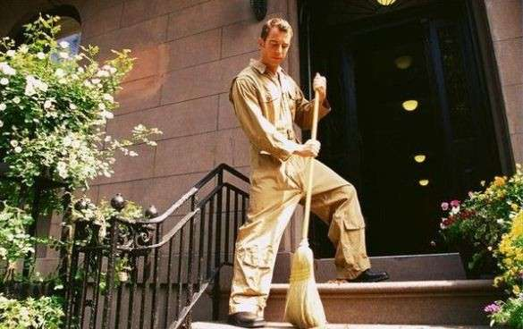
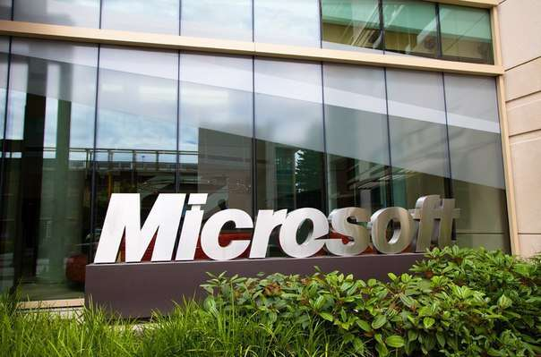

# “MICROSOFT”-ын талбайн цэвэрлэгч

“MICROSOFT”-ын, гадна талбайн цэвэрлэгчээр ажилд орохоор нэг хүн ярилцлагад оров. Хүний нөөцийн мэргэжилтэн, зохих тестийн дагуу ярилцлагууд авсаныхаа дараа:\
-Танд баяр хүргэе, та тэнцлээ. Өөрийн e-mail хаягаа үлдээнэ үү, ажлын графикийг чинь мэдээлэх болно\
-Надад, e-mail бүү хэл компьютер ч байхгүй гэж, өнөөх хүн үнэнээ хэлэв\
-Уучлаарай, харамсалтай нь, ийм тохиолдолд, бид таныг ажилд авч чадахгүй нь. Манай бүх үйл ажиллагаа цахимаар явагддаг юм. Үүнээс багийн ажиллагаа хамгийн их шалтгаалдаг, гэснээр ажилд орж чадаагүй залуу компьютер авахаар шийдэн, мөнгөтэй болохоор, танил фермерчээсээ байсан 30 доллартаа алим авч, хүн хөдөлгөөн ихтэй гудамжаар явж зарахаар авав. Тэр, “амттай ашигтай, эко хүнсээ аваарай” гэж санал болгосоор цагийн дотор 30 доллар нь нэг дахин өсч, 6 цагийн дараа гарааны доллар нь 10 дахин өссөн байлаа. Энэ үедээ, тэр ажил олгогчоос шалтгаалахгүй амьдарч болохыг ойлгосон бөгөөд ажил нь амжилттай явснаар, машин авч унан, дараа нь жижиг лангуутай болж, тэр нь дэлгүүр, дэлгүүр нь сүлжээ дэлгүүрүүд болон өргөжив. Тэрээр, ажил бизнесээ даатгуулахаар шийдэж, нэгэн даатгалын компанид хандсан бөгөөд, даатгалын төлөөлөгч мөн энэ удаа e-mail хаягаа үлдээхийг хүсчээ. Бизнесмен залуу, урд өмнөхийн адил e-mail хаяг, компьютергүйгээ хэлтэл, нөгөө төлөөлөгч, -“Ямар сонин юм бэ! Та ийм асар том бизнестэй байж, компьютер ч үгүй. Хэрэв байсан бол юунд хүрэх байсан бол?” гэж шагширав. Харин бизнесмен залуу маань, -“Би компьютертэй байсан бол ”MICROSOFT”-ын талбайн цэвэрлэгч байх байлаа” гэж хариулжээ.
