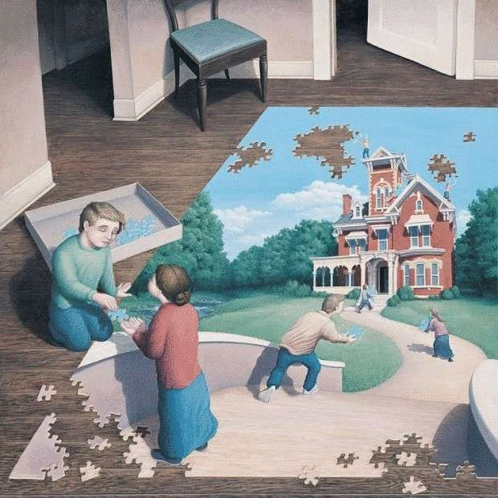

# “Микеланджелогийн үзэгдэл”: Хамтын амьдралд бие биенийхээ хүсэл мөрөөдлийг хуваалцах нь хамгаас чухал

Хүн бүр, өөрийгөө сайхан төрхтэй, эрч хүчтэй, ямар нэг гадаад хэлтэй, гавъяа шагналтай, нэр хүндтэй байх, ер нь төгс сайхан байхыг мөрөөдөн байдаг. Харин хүн энэхүү хүсэмжит мөрөөдлөө биелүүлэхэд, мөн “Төгс би”-гээ төлөвшүүлэхэд, хажууд нь хамт байгаа хүн нь, тэрхүү мөрөөдлийг нь хуваалцаж, хүслийг нь гүйцэлдэхэд гол чухал үүрэг гүйцэтгэдэг гэнэ. Микеланджелогоос, “Та энэхүү гайхалтай бүтээлүүдээ хэрхэн хийдэг юм бэ?” гэж асуухад, тэрээр, “Би зүгээр нэг чулуу аваад хэрэггүй зүйлсийг нь хасчихдаг юм” гэж хариулсан гэдэг. Яг ийм маягаар бид , бие биедээ нөлөөлж бие биенээ бүтээж, мөн бие биенээ харж далд ухамсраараа толь мэт хүлээн авч, дэргэдэх хүнийхээ хараан дор өөрчилөгдөж байдаг аж. Америкийн нэрт сэтгэл зүйч Стивен Дриготас, Кэрол Рабсулт нар, бидний хайртай, ойр дотны хүмүүс маань биднийг уран баримал барих мэт барьж, бид мөн өөрсдөө хариу үйлдпэл хийж байдаг гээд энэхүү судалгааны үр дүнгээ Микеланджелогийн үзэгдэл хэмээн нэрлэжээ. Энэхүү бие биедээ нөлөөлөх нөлөөлөл ашигтай, саармаг, мөн хор нөлөөтэй ч байх боломжтой. Хүний хувь хүний зан чанараас шалтгаалсан, хэн нэгэндээ илүү нөлөөлөх боломж нь, хэн нь илүү хүчтэй зан араншинтай байгаагаас. хамааралтай байдаг байна. Жишээ нь, нэг нь спортод дур сонирхолтой, үүнийг нөгөөх нь дэмждэггүй. Эсвэл нэгнийхээ энэ чадваруудыг нь үнэлэхгүй, эр нөхөр гэрийн эзний хувьд таарахгүй чанар гэж үздэг. Мөн нөхөр нь ямар нэг салбарын чадварлаг мэргэжилтэн, гэхдээ ажил мэргэжлээ солих хүсэлтэй. Харин эхнэр нь тэр шийдвэрт нь дургүйгээс тухайн хүн өөрийгөө төсөөлдөг тэрхүү ирээдүйдээ хүрч чадахгүй байх гэх мэт... Ухамсартайгаар эсвэл далд ухамсарын хэмжээнд, санаатай санаандгүй хийж буй хүслийг нь боогдуулсан эдгээр үйлдлүүд нь ийнхүү хүнд нөлөөлж хүчээр өөрчилөгдөх явц явагдаж эхэлдэг. Нэг нь нөгөөхөө уран баримал барих мэт өөртөө таалагдахаар барьж байна гэсэн үг. Энэхүү, хүний “Би”-г устгах үйлдлийг хамтын амьдарлыг жаргалгүй болгох сэтгэл зүйн хамгийн аюултай үзэгдэл гэж үздэг байна. Хосууд бие биенээ ойлгохоо больж, илүү хүчтэй нь нэгийгээ, өөрөөрөө байлгаж эхэлснээр ойлголцол үгүй болж, хайр, хамтын амьдрал мөхнө. Тиймээс бие биенээ дэмжих, нэгнийхээ хүсэл мөрөөдлийг ойлгох, дэмжих хамгаас чухал бөгөөд хэн нэг нь өөрийнхөө үзэл бодлыг тулгасан амьдрал бат бэх байж чадахгүй юм. Нэгнийхээ дэмжлэгтэйгээр аажмаар хэн болохыг хүссэн, мөн мөрөөдөж байсан түвшиндээ хүрч буй хүн сэтгэл хангалуун амьдарч, сэтгэл зүйн асуудлуудад бага өртдөг. Ийм харилцаа нь бие биедээ илүү дотносох, нээлттэй байх, итгэлцэлтэй байх, улмаар илүү ихээр бие биенээ хайрласан сайхан хамтын амьдралд хүргэдэг байна
