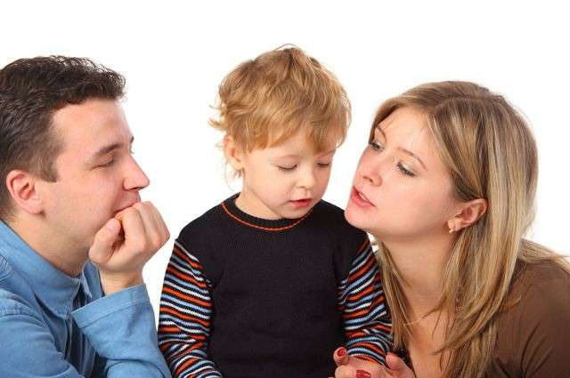

# “Миний ээж” сэдвээр, хүү нь ээжийгээ дүрслэн бичсэн хөгжилтэй зохион бичлэг

Миний ээж гуалигдуу л даа, гэхдээ, өөрөө, хөлөө урт биш гээд урт болгодог аймаар, өндөр өсгийтэй гутал өмсдөг. Тэгээд хөл нь өвдөөд байдаг юм. Толгой нь минийхээс арай том, яагаад гэвэл ээж маш ухаантай. Нүүрэн дээр нь, урт сормуустай хар нүд байдаг. Сормуус нь заримдаа мэдэгддэггүй сонин. Нүднийхээ дээд талыг янз бүрээр буддаг. Хөмсөг нь дандаа хэвээрээ байдаг. Уруул нь ямар өнгөтэйг мэдэхгүй, яагаад гэвэл өмссөн хувцастай нь бараг адилхан байдаг. Бас манай ээжийн шүд нь тэгшхэн цагаан. Хүзүү нь урт, би яагаад мэддэг вэ? гэвэл хүзүүнийх нь гинжийг нь харахаар, тасарчих гээд байгаа юм шиг болохоор хаяж уу үгүй юу гэж харж байдаг л даа. Тэрний мөр нь өргөн. Гэхдээ зохьдог. Гар нь ёстой гоё, хумс нь дандаа янз янзын өнгөөр будаастай байдаг. Ээж бид хоёрын яс бүдүүн юм шиг санагддаг, яагаад гэвэл ээж гуяараа бүдүүн. Ээжийн хөл нь тэгшхэн, яагаад гэвэл хугалаагүй юм чинь. Би, ээжийг загвар өмсөгч болох байсан байх гэж боддог, гэхдээ ээж, намхан учраас тэд нар авахгүй байх...\
Сонирхолтой нь, аав маань, нулимс нь гараад, өөрийгөө битгий дүрсэлж бичээрэй гээд их гуйсан шүү.
