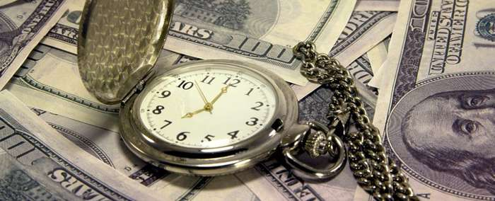

# Мөнгөгүй болохоосоо бүү ай

Мөнгө нь, хүмүүсийг хамгийн их өөрөөсөө хамааралтай болгодог, амьдралын хэрэгсэл юм.

Мөнгөгүй болох нь, мөнгө дуусах нь гэсэн бодлууд хүнийг улам мөнгөгүй болгодог гэнэ. Бага цалинтай бол, түүнийгээ голох нь мөн доройтуулдаг байна. Байгаа зүйлдээ баярлаж алив болгоомжлолгүй амьдрахыг хичээх хэрэгтэй бөгөөд мөнгөгүй болохоос айх айдас нь муу үр дагавартай байдаг ба айдас хамгийн их энергитэй сэтгэл хөдлөлд тооцогддог учраас тухайн айсан зүйлд маш хүчтэй нөлөөлж муу үр дүнд хүргэдэг байна. Мөнгөгүй болохоос айх зуршлаас салахын тулд, байгаа байдалтайгаа эвлэрч, байгаа зүйлдээ сэтгэл хангалуун байж сурах ёстой. Аливаа зорилгод хүрэхийн тулд мөнгө хэрэгтэй гэсэн, бидний бодол, зорилгыг маань үгүй хийж зорилго маань мөнгө болон хувирдаг. Гэтэл мөнгө нь, зорилгын дагуул гэдгийг мэдэхгүй, зорилгоо мартаж зөвхөн мөнгө бодож төөрөлддөг. Иймээс, авах зүйл, хүрэх зорилгынхоо тухай бодсоноор, мөнгө дагаж ирнэ гэдэгт итгэлтэй байх хэрэгтэй байдаг аж. Мөнгөнд мөн, хүндэтгэлтэй хандах хэрэгтэй ба жижиг дэвсгэртүүдийг ч голохгүй хандах нь мөнгөнд хүрэх зам болдог. Мөнгөөр эд зүйлс худалдаж авахдаа огтхон ч харамсаж болдоггүй, мөнгө хийх үүргээ гүйцэтгэж байна гэсэн ойлголтыг оюун ухаандаа суулгах хэрэгтэй байдаг байна. Мөн, мөнгө хөдөлгөөнд байх зориулалттай тул, харамлаж, хураах нь сайн зүйл биш ба бүхнээ алдах эрсдэлийг дагуулах магадлалтай гэнэ. Тиймээс ч нэртэй баячууд байнга буяны байгууллага болон бусдад хандив өргөж байдаг ажээ.
