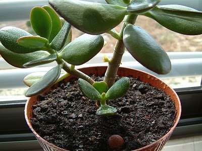

# Мөнгөний модыг эмчилгээнд ашиглах нь

Магадгүй энэ ургамал гэрт тань ургадаг байж магад. Олны дунд мөнгөний мод /толстянка, fagot/ гэж нэрлэгдддэг бөгөөд мөнгө татдаг гэдгээс олон айл гэр тарьж ургуулж итгэл алддаггүйгээс биз ихэд дэлгэрсэн, энэхүү ургамлын эмчилгээний чанарыг танилцуулъя.

1. Хомхой долооход, навчийг нь шахаж, гарсан шүүсийг уг шархан дээрээ түрхэх\
2. Артрит, артроз. 10-15 ширхэг навчны шүүсийг шахаж оройд, өвдөлт, үрэвсэлтэй үеүддээ түрхэх\
3. Геморрой буюу цагаан мах эргэхэд, уртааш нь зүссэн навчийг тухайн хэсэгтээ тавина. Тэр дороо нөлөөлдөг\
4. Түлэгдэлт, хөхрөлт няцралт, шарх, буглаанд навчийг жижиглэж няцлан тавьж бооно. 2-3 цаг болоод дахин сольж тавьна\
5. Ходоод, арван хоёр нугалаа гэдэсний шархлаа. Өлөн элгэн дээрээ 2 ширхэг навчийг сайтар зажилж идэх\
6. Пиелонефрит, цистит. 5 ширхэг навчийг жижиглэж нухаад 1 стакан халуун усанд хийж цаг орчим тавьж байлгаад шүүн, хоолноос 15 минутын өмнө 1 хоолны халбагаар 3 удаа уух\
7. Ангин, тонзиллит. 10 ширхэг навчны шүүсийг шахаж 1 стакан усанд хийж хоолойгоо зайлна. \
Анхаарах! Уг ургамал мышьякийн өндөр агууламжтай байдаг тул дооз хэтрүүлэн хэрэглэж болохгүй.
