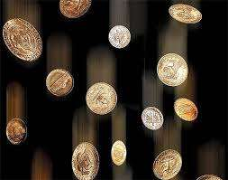

# Мөнгөтэй зөв харьцах нь

Ер нь, мөнгөтэй харьцах талаар зөвлөмжүүд, далд хүч, ид шид, эзотериктой холбооотой байдаг. Үүнд, итгэх эсэх нь, таны эрхийн асуудал юм. Хүн, мөнгө төгрөгтэй харьцах үед, хүний тархи, мөнгөнд төвлөрсөн, чиглэсэн долгион ялгаруулж эхэлдэг, мөн асар их мөнгө нь, харсан хүний сэтгэл хөдлөлд нөлөөлдөг, мөнгө бол олонхи хүний хүсэл, мөн хүмүүсийг баярлуулж чадах, дайсагнуулж чадах нөлөөлөлтэй зэрэг нь биднээс хамааралгүй явагддаг, далд ухагдахуун гэдэгтэй хэн ч санал зөрөхгүй биз ээ.

-Мөнгө танд зориулагдсанаас бус, та, мөнгөнд зориулагдаагүй гэдгийг ойлгох хэрэгтэй\
-Мөнгийг үнгэж үрчийлгэхгүй, хүндэлж хайрлаж харьцах хэрэгтэй. “Мөнгөний амь”, түүний урсгалыг барьж авахыг хичээх, өөртөө дасгах, хүлээж авах үйлдлийг хийж бай. Мөнгө, тайван, бодлоготой, хоосонгүй хүмүүст дуртай байдаг\
-Мөнгө, хүнтэй адил эрх чөлөөнд дуртай, мөн хэн нэгэн хайрлавал тэр газартаа тогтдог. Мөнгийг их бага дэвсгэртээр нь ялгаж салгахгүй харьц\
-Мөнгөтэй болохын тулд баян чинээлэг хүмүүстэй харьцах сайн, бөгөөд мөнгө, эд баялаг нахиалах увидастай гэдэг\
-Мөнгөөр тооцоо хийхдээ, илүү төлөхгүй мөн өөрийгөө хууруулахгүй байх хэрэгтэй. Энэ нь, мөнгийг дорд үзэхгүй байна гэсэн үг\
-Барааны үнэ, ажлын хөлсийг цаг тухайд нь шударгаар өгч бай. Энэ нь мөнгөний эргэлтийг дэмждэг\
-Орлого бүрээс бага ч атугай хадгал. Мөнгөний хүчийг дэмжинэ\
-Мөнгөний талаар муугаар бүү бод. Тэд, ухаантай, анхааралтай, дуулгавартай мөн гомдох ч чадвартай. Хэт шунал мөн тэднийг айлгадаг. Мөнгөний төлөө, үхэлдэн зүтгэх хэрэггүй. Мөнгийг дотно, төрөлх зүйл мэт хүлээн авч, бодож бай. Тэд мөн адилхан хариулна\
-Мөнгийг зээлдүүлэх нь, мөнгөний тань хүчийг сулруулдаг. Ойр дотныхондоо, туслах сэтгэлээр өгч болдог. Үрж тарах магадлалтай хүнд, мөнгө бүү өг, зээлүүл. Оройд, амралтын өдрүүдэд, мөнгө гаргахгүй нь дээр гэдэг. 2-р эхэлсэн мөнгө хүнд өгөхөд, буцаж ирэхгүй магадлалтай байдаг гэнэ\
-Хандив, тусламжид мөнгө өгч бай. Буян болохоос гадна хэзээд буцаж орж ирдэг. Гэхдээ, хандив, татвар, тусламж, буяны үйлсэд өргөх мөнгө нийлээд, орлогын 30%-с хэтэрч болохгүй. Өгсөн авсан, аль алинд ашиг тусаа өгөхгүй гэдэг\
-Мөнгө тоолуулах дуртай байдаг. Энэ бол тэдний хувьд энхрийлэл тул баяртай тоолж байх хэрэгтэй гэнэ. Сарын эхний өдөр ба сүүлийн өдөр тоолж бай, хэрэв дансанд байгаа бол, тоог нь мэдэж авч бай. Нар жаргаснаас хойш тоолдоггүй. Өвдгөн дээрээ тавьж тоолох, хүний гараас өмнгө авахыг таагүй гэдэг\
-Мөнгө, хамаагүй үрж тарах, цацахад дургүй, мөнгөний урсгал тасарна гэдэг. Үнэлүүлэх дуртай ба зөвхөн хэрэгцээт зүйлсдээ хангалттай зарцуулахад дуртай\
-Хэн нэгний өмнөөс мөнгө хийхийг бүү оролд. Мөнгө нэг л эзэнд дуртай байдаг. Олж буй мөнгөө насанд хүрээгүй л биш бол бусдад зарцуулахаас болгоомжил. Мөнгө орлого хүн бүрд ижил заяагддаг тул сул мөнгө өгч буй хүний тань орлого, боломжууд нь хаагдна гэдэг\
-Мөнгө эргэлтэд дуртай тул, мөнгөө өсгөх болмжуудыг эрж хайн, эргэлтэд оруулахад дуртай. Ийнхүү мөнгөө өсгөхийг эрмэлзсэн үйлдэл тань, эргээд мөнгө танд үйлчлэх боломжийг олгоно. Энэ харилцан үйлчлэл мөнгө, хүн хоёрыг салшгүй нэгэн бүхэл болгодгийн шилдэг жишээ бол, бидний мэдэх мөнгө хийхийн учрыг ойлгож, мөнгийг удирдах чадварыг эзэмшсэн хүчирхэг, нэр бүхий тэр бумтанууд юм. Тэднийг, мөнгийг зорилгодоо хүрэх хэрэгслийн хэмжээнд чадамгай ашигладаг, мөн мөнгийг өсгөх боломжуудыг эрж хайхдаа гарамгай, ухаантнууд, амьдралыг хөдөлгөх хүч гэж үздэг.

Мөн, баян хүн гэж их мөнгөтэй хүнийг бус харин мөнгө нь, байгаа зүйлсэд нь хангалттай хүрдэг хүнийг хэлнэ гэж үздэг ба хүн, хэт баян байх албагүй, мөн ядуу байх ёсгүй гэсэн нэгэн ухаантны үгийг санаж явах хэрэгтэй биз ээ.
