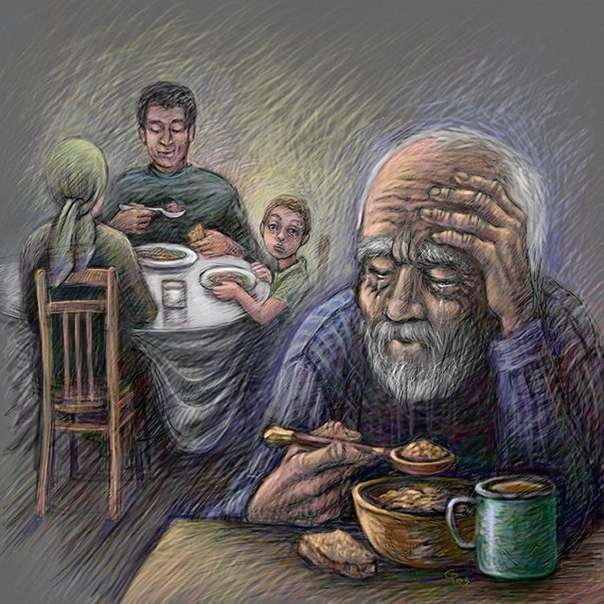

# Модон аяга

Бид, эргэн тойронд болж буй бүх зүйлсийг, өөрт таалагдахгүй, өөрсдийнхөөр маань болохгүй бол, тухайн таагүй зүйл, тэдгээрийг хийж байгаа хүмүүст уурлан ундууцаж, бухимдаж байдаг маань нууцгүй билээ. Гэтэл, бид ч өөрсдөө, бусдыг бухимдуулах байдалд орох боломжтой гэдгээ мэддэггүй. Энэ хорвоогийн бүх зүйлс, бидний бусдад хийсэн, таатай, таагүй зүйлс бүгд заавал эргэж ирдэг, нэгэн ертөнцийн нууцлаг хууль үйлчилж байдгийг, тэр бүр санахгүй амьдарцгаадаг. Тиймээс, дараа нь харамсах байдалд орохгүйн тулд, аливаа алдаа гаргахгүйг хичээн амьдрах ёстой байдгийг харуулах нэгэн сургаалт өгүүллийг хүргэе.

Нэгэн хүн, нас нь өндөр болж, хүү бэр хоёрындоо хамт амьдрахаар нүүн иржээ. Түүний хараа насны эрхээр муудаж, гар хөл нь салганан, муу явдаг болсон байв. Тэд хамт хооллохоор суух үед, хөөрхий өвгөний гар нь салганан хоол ундаа асгаж цутган, хараа муугаас болох болохгүй зүйлийг хооронд нь холих зэрэг үйлдлүүд байнга гаргана. Энийг нь харсан хүү, бэр хоёр нь мөн, байнга уурлаж бухимдана. Ингээд нэг өдөр, хүү нь, эхнэртээ, -Я мар нэг зүйл хийе, хоол ундаа асгаж цутгаж завааруулах юм, ямар ч муухай дуу чимээтэй иддэг юм гэж хоорондоо ярилцаад, өвгөнийг өрөөний мухарт буруу харж суусан байрлалтай байхаар, жижиг ширээ тавьж тусад нь хооллуулах болов. Тэр, ганцаар буруу харж суун, уйтгар гуниг дүүрэн, заримдаа ч нүдэндээ нулимстай, асгаж цутган хоолоо иднэ. Тэр хоёр ч удаа, тавгаа хагалсан тул, түүнд модон аягаар хоол өгөх болжээ. Мөн, тусдаа хооллодог, болсноос хойш, хааяа халбага сэрээгээ унагах зэрэгт нь уцаарлаж загинасан ганц хоёр үг хэлэхээс өөр, хэн нь ч түүнтэй харьцахаа болив. Энэ бүхэн, хүүгийнх нь өмнө болж өнгөрсөн бөгөөд, хүү нь харахаас өөр юм хэлэхгүй бяцхан, 4 настай. Нэг орой, хүү нь өрөөндөө, баахан модны зоргодсон дунд сууж байхыг харсан эцэг нь, -Чи юу хийж байгаа юм бэ? гэж гайхан асуув. Хүү нь, тэгтэл, -Би, ээж, та хоёрт том болохоороо хоолыг чинь өгөх модон аяга хийж байна, гэж хэлээд хийж буйгаа үргэлжлүүлэх аж. Үүнийг сонссон, эхнэр нөхөр хоёр, нулимс цийлэгнэсэн нүдээр бие биенээ харан, хэсэг хугацаанд, хэн хэндээ хэлэх ч үггүй, зогсоцгоов. Гэхдээ тэр хоёр юу хийх хэрэгтэйгээ хоёулаа мэдэж байлаа. Хооллох цаг болж, хүү нь аавыгаа энхрийгээр түшин хоолны ширээндээ суулган, үлдсэн хугацаанд нь, тэд үргэлж хамт хооллон өнгөрүүлсэн гэдэг. Яагаад ч юм тэр хоёрын хувьд, аавынх нь хоолоо асгаж цутгах, бүтээлэг завааруулах нь, бухимдал, уцаарыг нь төрүүлэхээ больсон аж.
