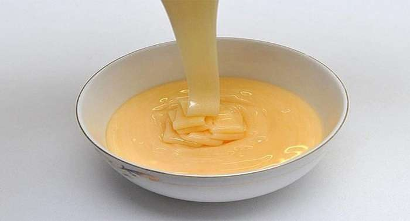
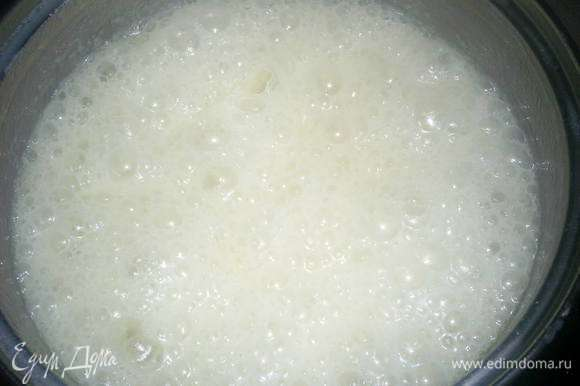

# ”Молоко” буюу өтгөрүүлсэн сүүг 15 минутад хийх арга

#### Орц:

Сүү 200 грам\
Элсэн чихэр 200 грам\
Масло 20 грам

#### Бэлтгэх:

-Сүү элсэн чихэр, маслаа, гүнзгий ёроолтой саванд холиод, зөөлөн гал дээр тавьж буцалмагц галаа нэмэн яг 10 минут чанана. Маш их хөөсөрдөг тул гүнзгий ёроолтой саванд чанахыг дахин сануулъя. Чанасны дараа шингэн байж байгаад хөрөх явцдаа өтгөрдөг. Тиймээс, тасалгааны температурт хэсэг хөргөөд,жижиг саванд юүлэн хөргөгчинд тавих хэрэгтэй. Ингээд, 15 минутын дотор амт, өнгө нь дэлгүүрийнхээс ялгарахгүй “молоко” таны гараар бүтнэ. Үнэхээр амттай шүү!
