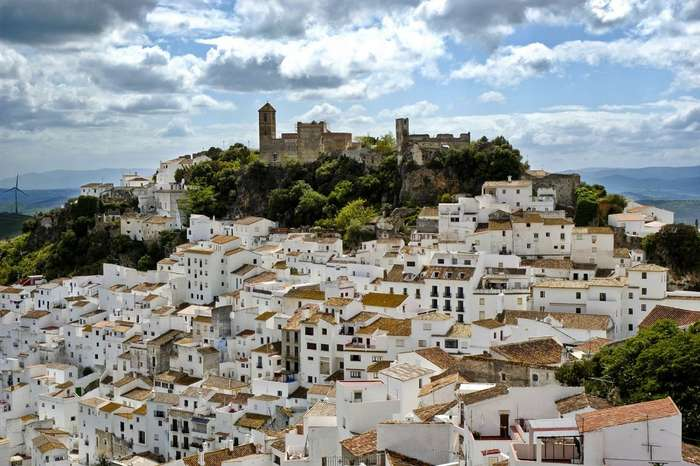
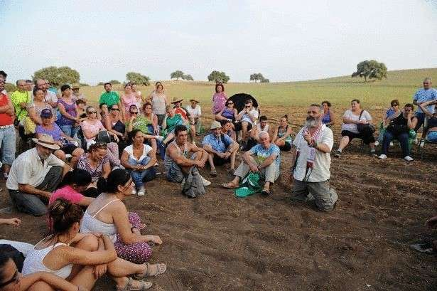

# Монголын “Робин Гуд” маань, хаана явна?

Магадгүй, Та, энэ мэдээг уншаад, монголын “Мариналеда”-г байгуулах ч юм билүү? Таны, сайхан үйлсийн тухай мэдээг олон нийтдээ хүргэх, тэр өдрийг тэсэн ядан хүлээе. Та, чадна аа!

Испанийн, “Мариналеда” гэдэг энэ хотод, гэмт хэрэг, ажилгүйдэл байдаггүй, Энд, цагдаагийн газар байдаггүй. Оршин суугчдынх нь дундач цалин, 1200 евро. Энэ хотынхон, жинхэнэ “үл гүйцэлдэх” гэгддэг, шударга нийгмийг байгуулж байна. Энэ хотын хүн ам цөөн, 2700-д оршин суугчидтай. Испанийн өмнөд хэсэгт орших алсдагдсан, хамгийн ядуу, хүнд амьдралтай мужид хамаарагддаг бөгөөд бусад, зэргэлдээх хот суурин газруудаасаа тэс өөр амьдрал,орчин ахуйг энд, цогцлоож байгаа нь, олны гайхлыг төрүүлж байна. Испанийн эдийн засгийн хямрал эхэлж байх үеийн, 2008 онд, энэ хотынхон, тэр үедээ, “Испанийн Робин Гуд” гэдэг хочтой, Хуан Мануэл Санчес Гордилло гэгч, олны хайр татсан нэгэн улс төрчийг хотын даргаар сонгосноос хойш, хотынхны амьдрал ахуй танигдахаа болтол өөрчлөгджээ. Испанид одоо, эдийн засгийн ноцтой хямрал болж байгаа бөгөөд, энэ мужийн бусад хот сууринд, зээлээ төлж чадаагүйн улмаас банканд хураагдсан, 690 000 хоосон байр, эзэнгүй байдаг. Ажилгүйдлийн түвшин нь, 55% д хүрсэн асар хүнд байдалтай байгаа энэ үед, энэ жижиг хотынхон яаж ийм байдалд хүрэв ээ? Хотын захирагч нь, уг хотынхны эрхэлдэг, оливын тариалангийн аж ахуйнуудыг нэгтгэж, боловсруулалт, борлуулалтын бүх асуудлуудыг шийдэж, олсон орлогыг тэнцүү хувааснаар ажил орлогогүй хүн байхгүй болсон бөгөөд, орон сууцны асуудлыг нь, хотын санд цугларсан, дундын мөнгөнөөс үнэгүй барьж өгдөг болсон ажээ. “Бид, аминч үзэл, хувийн ашиг сонирхол, мөнгөний тухай мартаж, ард иргэдийн хэрэгцээ, түүний үнэ цэнийг ойлгосон цагт, үүнээс ч илүү хангалуун аз жаргалтай, шударга орчинг бүрдүүлэх боломжтой” гэж, хотын дарга Гордилло, итгэл дүүрэн ярьж байна. Жижиг ч бай энэ хотынхныг, баталгаатай амьдралд хүргэсэн, “шударга дарга”-н тухай, уншихад хүртэл, танд, таатай байгаа гэж итгэж байна. Манайд, нэг сумыг ч атугай шударгаар удирдаад, “Мариналеда” шиг болгочих, “Робин Гуд” байна уу? Монголын “Робин Гуд” маань, хаана байна аа!!!
