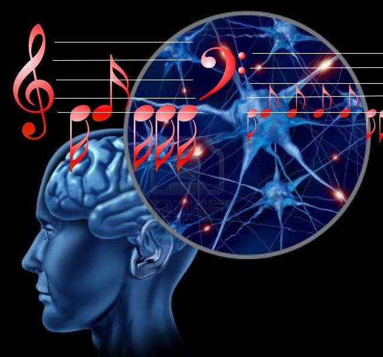
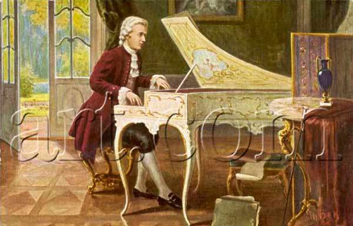

# Моцартын хөгжим ухамсарт нөлөөлдөг болохыг эрдэмтэд нотолжээ

Венийн агуу, сонгодог хөгжмийн зохиолч Моцарт, 21-р зууны эрдэмтэн судлаачидын “туршилтын туулай” болсон урт удаан судалгааны эцэст, түүний хөгжим аязууд, хүний сэтгэхүй, ухамсарт гайхамшигтай нөлөөлж, эерэг үр дүн үзүүлдэг болохыг тогтоожээ. Сод авъяастан, “нарны хүн” гэх Моцартын зохиосон хөгжим, бидний ухамсар сэтгэхүйтэй хэрхэн ажилладаг юм бол?

Вольфганг Моцарт, хөгжмийн сургуулилалтаа маш эрт, 4 настайдаа эхэлсэн гэх бөгөөд тэр үедээ эхний аязуудаа зохиож байсан гэдэг. Эцэг нь, түүнийг хатуу гараар хүмүүжүүлж, байнгын сургуулилалтаас гадна, 5 настайгаас нь концерт тоглуулж эхэлсэн ба Леопольд Моцарт, тэр үеийнхний ёс журмаар, зөвхөн ариун журамтай хүн л хөгжимчин болно гэсэн үзлийг баримталдаг байв. Бяцхан Моцарт, өсвөр насанд хүрэхээсээ ч өмнө ариун журамт хүн хэмээн хүлээн зөвшөөрөгдсөн бөгөөд энэ нь, тэр үеийн язгууртануудын өмнө тоглох олон цагийн тоглолтууд, түүнд бэлтгэх асар их хүчин зүтгэлээр олдсон аж. Нэг удаа, хатан хаан Мария Терезагийн өмнө тоглосон тоглолтын дараа, халуурч дагжин биеэр нь улаан толбо туурсаныг хааны эмч эмчилж эдгээж байсан гэдэг. Аав нь түүнийг дагуулан, европын хаадын орднуудаар тоглуулж “хэсүүчлэн”, тодорхой суурьших газар эрэлхийлэн амьдарч байсан бөгөөд энэ үед, бяцхан хүү Моцарт, мөнгө төгрөгний дутмаг байдал, байнгын гэр оронгүй тав тухгүй амьдралыг туулж, тэвчин өнгөрүүлдэг байжээ. Гэсэн ч энэ байдлаа үзүүлдэггүй байсан бөгөөд хөнгөн сэргэлэн зан ааш, алиа хошин харилцаа, хөгжилтэй зан чанарыг нь, тухайн үеийн үзэгчид, нийгэм нь ихэд талархан магтаж хүлээн авдаг байсан аж. Тэр, язгууртануудын хүлээн авалт, бүжиг, багт наадамд дуртайяа оролцон цагийг хөгжилтэй өнгөрүүлдэг байсан нь, түүний хөгжимд тусгагдсан байдаг. Түүний хөгжим, бусад хөгжимийн зохиолчидын бүтээлүүдээс, хэд дахин их өндөр давтамжууд болох, 3000-с 8000 герцийн дунд хэлбэлзэх давтамжуудтай байдгаас, сонсож буй хүмүүсийн хувьд, хавар, нар, “цацраг” гэсэн туяарах мэдрэмжийг төрүүлж байдаг гэнэ.\
Моцартын хөгжимийн судалгааг, анх хулганууд дээр туршжээ. Эдгээр амьтдад, 2 сарын турш, 12 цагаар моцартын нэг л хөгжмийг сонсгосон бөгөөд хөгжим сонсогч хулганууд маань гэнэт бусад хулгануудаасаа ухаантай болж, хурдан гүйдэг, зориулалтын саадтай замаар хамгийн түрүүнд бага алдаа гарган байндаа очдог болсон аж. Хүмүүс дээр туршсан анхны туршилт мөн гайхалтай үр дүн харуулсан бөгөөд, нэг хэсэгт нь Моцартын хөгжим сонсгож, нөгөө хэсэгт нь ердийн хөгжимүүд сонсгон тархины идэвхижил хэмжигч апаратаар хянах явцад, дурын аязуудыг сонссон хүмүүсийн, тархины сонсголын эртэнтэй холбоотой хэсэг идэвхжиж, тодорхой хэмжээний сэтгэлийн хөөрөлд нөлөөлж байсан бол, харин Моцартын хөгжим, хүмүүсийн тархинд нэлэнхүйд нь нөлөөлж байгаа нь харагджээ. Үүнийг ажиглаж байсан эрдэмтэд, хүний толгой тэр чигтээ гэрэлтэж эхлэх мэт байдалд орж байна гэж тэмдэглэсэн бөгөөд зөвхөн Моцартын хөгжимд, хүний мэдрэлийн системд тохирсон өвөрмөц ритм, давтагдашгүй нэгэн өвөрмөц хэмнэл зонхилж байна, хүний тархинд 20-30 секундын давтамжид хэлбэлзсэн нэгэн тайлагдашгүй зүйл, үелзэл үйлчилж байна гэж дүгнэжээ. Энэхүү судалгааны ажил дээр үндэслэн, 20-30 секундын давтамжит үелзэл бүхий хөгжим аязыг, бусад хөгжмийн бүтээлүүдээс эрж хайх судалгаа хийж, хүснэгт гаргасан бөгөөд бусад сонгодог бүтээлүүд, цаг үе бүрийн хит ая, аязуудыг судлахад, яалт ч үгүй хамгийн нэгдүгээрт Моцартын хөгжим бичигдсэн дүгнэлт гарсан байна.
