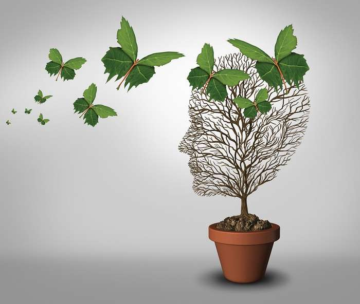

# Муу зүйл бүү бод – өвчилнө!

Эртний алдартай эмчилэн анагаагч, дэлхийн түүхэнд алдар нэр нь мөнхрөн үлдсэн Авиценна, -“Эмч хүнд өвчинийг анагаах гурван хэрэгсэл байдаг. Энэ нь үг, ургамал, хутга юм” гэж хэлдэг байжээ. Үг хамгийн түрүүнд байгааг хүн бүр анхаарах хэрэгтэй юм. Парисын нэгэн эмнэлгийн сэтгэл зүйч эмч Эмили Кьи, үр дүнд нь эргэлзэж, эмээж болгоомжилж байсан ч, тухайн эмнэлгийнхээ ерөнхий эмчийн албан тушаал хашдагаа ашиглан, өвчитнүүддээ өдөр бүр, өдөрт 3 удаа 10 дахин “Бие минь өдрөөс өдөрт сайжирч байна” гэж давтан хэлж байх дүрэм гаргажээ. Тэгтэл, энэ эмчийн хариуцсан хүнд өвчитнүүдийн бие сарын дараа гэхэд гайхалтай сайжирцгааж, зарим хагалгаа хийлгэх оноштой өвчитнүүдэд мэс ажилбар хийх шаардлагагүй болсон байжээ. Энэ тохиолдлыг, “Итгэл гайхамшгийг бүтээдэг” гэж үргэлжид нотлохыг оролдож, ярьдаг байсан эртний грекийн эрдэмтэн Парацельсын дэвшүүлсэн таамаг үнэний хувьтай болохыг харуулж байна гэж хэвлэл мэдээллийнхэн Франц даяар шуугисан бөгөөд эрүүл мэнд бол тухайн хүнийхээ бодлын шууд үр дагавар, хүний сэтгэхүй ба бие мах бод шууд уялдаатай, үг бодлыг үүсгэнэ, бодол бие мах бодод шууд нөлөөлдөг гэсэн дүгнэлт нотлогдлоо гэж бичицгээж байв. Өвчилөхгүйн тулд амьдралын баяр баясгалантай байж зөвхөн сайн сайхныг бодох ёстой байх нь. Сайн сайхан зүйлс бодож амьдралаас зөвхөн сайныг л хүлээ. Бидний байнга бодож байдаг зүйлс маань итгэл үнэмшил болон хувирч, тэрхүү итгэл нь үйл явдлуудыг үүсгэж, үүнээс үүдсэн хүлээлт нь биелж байдаг байна. Америкийн зүрхний шигдээс, дутмагшилын эмчилгээгээр нэрд гарсан эмч Роберт Элиотын, 1/ Жижиг сажиг зүйлд битгий хямар. 2/ Бүх зүйл болоод л өнгөрөх тул хоосон гэсэн хоёр алтан дүрэм байдаг бөгөөд үүнийг амиа хамгаалах, хайрлах зэвсэг мэт хэргэлж занших хэрэгтэй. Тиймээс, өнөөдрөөс эхлэн бодлоо цэгнэн, зөвхөн сайн сайхан зүйлсийг бодож, олж харж, эерэг хүлээлттэй, бага сага зүйлд санаа зовохгүй, зөвхөн сайныг бодон эрүүл саруул амьдрах боломж гарт тань байгааг ойлгоорой. Та чадна аа!!!

