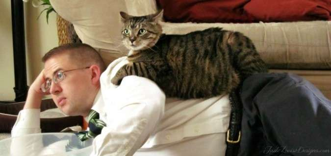

# Муур тэжээх нь хүний эрүүл мэндэд тустай

Эртнээс муурыг гаршуулан гэртээ тэжээж ирсэн нь гэр орон, хашаа хороонд үүрэлсэн мэрэгч амьтдаас хамгаалах, сэргийлэх зорилготой байсан боловч, мөн өөр эмчилгээний учир утгатай байдаг ажээ.

Өдөр бүр муураа эрхлүүлэхэд эзэн нь эрүүл мэндийн олон асуудлуудаас гарах сайн үр дүнтэй. Эрхлүүлэх үед муур хэржигнэх нь янз бүрийн нянг эсэргүүцэх, хүний дархлааг өсгөдөг. Мөн муурыг илэх үед өндөрссөн даралт буурдаг бөгөөд нэгэн хэмийн илэх хөдөлгөөн болон муурны хэржигнэх дуу хүнийг тайвшруулж бие булчинг суллаж амраадаг. Мөн энэ үед стресс, депресс, ядаргаа тайлагдах ба бүр шизофрени өвчний хурцдалтыг ч сулруулдаг байна. Муурыг артрит болон үе мөчний үрэвслийн үед бүлээн жин маягаар ашиглаж болдог. Гэхдээ эдгээр эерэг үр дүн нь муур өөрөө эсэргүүцээгүй, эзэнтэйгээ хамт байх дуртай байгаа тохиолдолд гардаг гэдгийг сануулах нь зүйтэй. Мөн эмчилгээний зорилгоор хүний муурыг ашиглаж болдоггүй.
