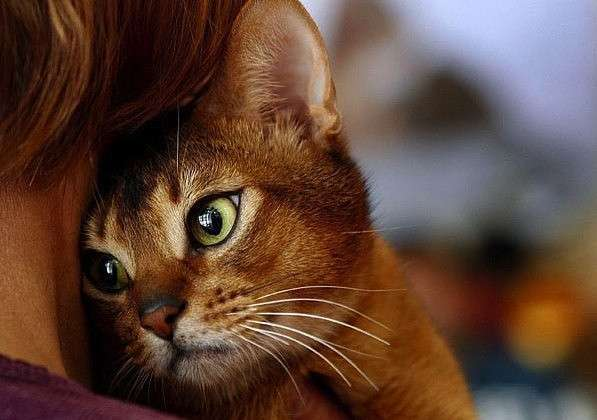
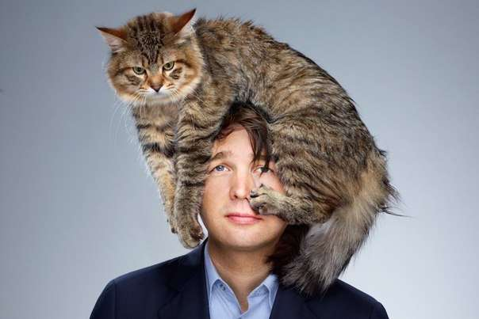

# Муур яагаад, хүний өвчтэй газар хэвтдэг вэ?

Муурыг хамгийн их дэлгэрсэн, гэрийн “анагаагч гэж үздэг”. Муур эзнийхээ өвчтэй газрыг олж хэвтэх чадвартай байдаг. Тэр газар нь биеийн дулаанаараа жигнэж, хүржигнэн эдгээдэг гэнэ. Хүнд өвчний үед муур эзнээсээ холддоггүй. Муур тэжээдэг, мууранд хайртай хүмүүс, муургүй хүмүүсээс 5 дахин бага өвддөг гэсэн тоо баримт байдаг байна.

#### Зүрх судасны өвчний үед

Зүрхний шигдээс болон цус харвалтаас эзнээ аварсан олон тохиолдлууд бүртгэгдсэн байдаг бөгөөд энэхүү өвчний эхлэлийг муур мэдэрч, урьдчилан мэдэгдэх чадвартай. Эзнийхээ, бие эвгүйцэхийг мэдэрч, сэрвээгээрээ өнхөрч мэдэгддэг. Зүрхний хүндрэлийг давтан явагдахаас сэргийлдэг. Муурыг илэхэд, даралт, зүрхний цохилт хэвийн болдог байна.

#### Ходоод гэдэсний өвчин

Муурыг илэх хоол боловсруулах ажиллагааг сайжруулдаг. Богино үстэй, үс багатай муурыг илэх энэ өвчний үед тустай

#### Стресс ядаргаа

Муур илэхэд ядаргаа тайлагддаг. Стресс, толгой өвдөх үед илэхэд, өвчин намдахаас гадна даралт бууруулж, зүрхний цохилтыг хэвийн болгоно. Хар муур, хүний муу энергийг хоёр дахин их шингээж салгадаг. Цайвар, саарал, цэнхэрдүү өнгийн муурнууд, энерги тэнцвэрлүүлж, тайвшруулдаг. Цагаан муурыг хамгийн, эмчилгээний чадвартай гэдэг байна.

#### Дархлаа сайжруулдаг

Хэрэв өдөр бүр, 4-16 герц байдаг, муурын хэржигнэхийг сонсоод байвал дархлаанд, сайн нөлөөлдөг байна. Эрдэмтэд, муурын хэржигнэхийг, ультра авианы эмчилгээтэй дүйцүүлэн үздэг. Энэ нь шарх хурдан эдгэх, ясны бэхжилтэд нөлөөлдөг байна. Перс муур, үе мөчний өвдөлт, зовиурыг дардаг

#### Нас уртасгадаг

Геронтолог судлаачид, муур эзнийхээ амьдрах хугацаанд нөлөөлдөг эсэх талаар судлаад, насаараа муур тэжээсэн хүмүүсийн наслалт, муургүй хүмүүсийнхээс 10.3 жилээр урт байдаг болохыг тогтоожээ. Мууртай хүмүүсийн даралт, хэвийн, цусандах холестириний хэмжээ бага байдаг байна.

#### Энерги мэдээллийн төхөөрөмж

Муурыг жинхэнэ энерги мэдээллийн төхөөрөмж гэж авч үздэг. Муур эзнийхээ толгойн хавьцаа хэвтээд байвал даралт ихэссэн эсвэл тархи толгойн өвчлөлтэй гэдгийг заадаг. Биеийн зүүн дал, мөр хавьцаа хэвтдэг бол зүрх судасны өвчлөлийг харуулдаг. Нуруу хавиар хэвтэх нь бөөр нурууны асуудлыг заана. Хөл хавьцаа тань хэвтдэг бол, бага даралттай болохыг заадаг байна.
