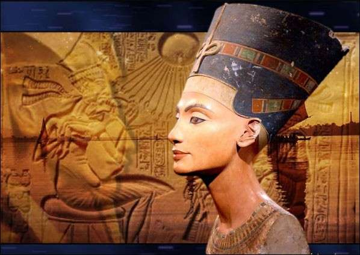
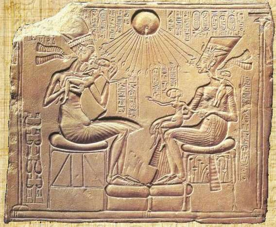

# Нарны охин, Египетийн хатан хаан гоо үзэсгэлэнт Нефертити

Гурван мянганы тэртээ, халуун тив Африкийн Фива хотод Нефертити төрсөн бөгөөд, төрөх үед нь нар хурцаар шарж байснаас Нефертити, Нефер, Неферу, Атон гэж олон янзаар нэрлэн өхөөрддөг байжээ. Нарны бурхан Атон түүний хувьд хар багаас нь хамгийн ойр, тиймээс ч тэр, аврал шүтээнээ болгон тахьдаг байжээ. Хөдөлгөөнтэй сэргэлэн, дуулж бүжиглэх дуртай нарны охин маань, үргэлж нар руу хандан гараа өргөн магтан дуулж, дуу бүжгээ зориулдаг байв. Асрагчийн хамт зах дээр ирж тэр, үеийн баян тансаг бараануудыг сонирхон явах үедээ, нимгэхэнээс нимгэн нарийн хуниаст маалинган бөс, хаад ноёдын зиндааны хиймэл үс, ганган чамин үнэт эдлэлүүд, биеийн үнэртүүлэгч тоснуудад ухаангүй дурлан шохоорхож, “ийм ганган бөсөөр хийсэн хээнцэр хувцас өмсөхийг хүснэм, тэрхүү сайхан үнэртүүлэгч тоснууд надаас үнэртэх болно, эрхэмсэг өндөр хиймэл үснүүд хэзээд надад зохьно доо” хэмээн эргэлдэн бүжиж дуулдаг байжээ. Тэрээр нар туссан бүхнийг харж баясан, нарны цацраг бүрт талархан, байгал дэлхийд хамгийн ойр байж, цэцэрлэгээр байнга зугаалах дуртай байсан ба өглөө бүр наранд дуулж бүжиглэн өргөл өргөдөг, орой нар шингэх үед,сайхан царайндаа бардам инээмсэглэлээ гайхуулан нараа үддэг байжээ. Нэгэн удаа зугаалж явах үед нь фараоны хүү Аменхотеп тааралдаж танилцан, гоо үзэсгэлэнт Нефертиттэй, байгалийн сайхан, түүний хүч, хүний амьдрал болон зорилгын талаарх яриа, үзэл бодол нь нийлж хэдэн цагаар ярилцсан гэдэг. Ийнхүү удалгүй нөхөрлөл нь хайр сэтгэл болж, удалгүй мөн гэрлэцгээжээ. Египтийн хааны хайртай гэргий Нефертити 6 охин төрүүлсэн бөгөөд эр нөхөр Эхнатон, охидуудын хамт үргэлж хамт зоог барьдаг, эв найртай гэр бүлийн билэг тэмдэг болсон гэр бүл байсныг Эртний Египтийн хадны зургууд дээр, Нефертити Эхнатон хоёр хүүхдүүдтэйгээ цуг сууж Нарны бурхан Атон олон цацрагт гараа хааны гэр бүлрүү сунгасан байгаагаар дүрсэлж мөнхлөн үлдээсэн байдаг. Ийнхүү нартай төрж, нараа магтан дуулж, нараар тэтгүүлсэн, нарны охин Нефертити түүхэнд мөнхөрсөн ажээ.
