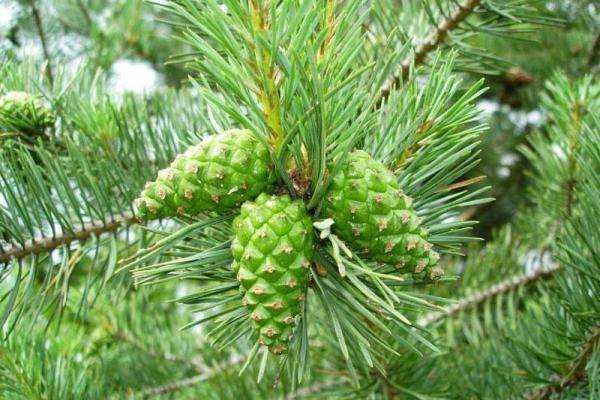

# Нарсны боргоцойн ханд, харвалтаас сэргийлэхэд болон, харвасны дараах үед тархийг сэргээх үйлчилгээтэй

Харвалтаас сэргийлэх болон харвасны дараа сэргээн засах эмчилгээнд нарсны боргоцойг, спиртэнд дарж хэрэглэхэд тустай байдаг байна.

5 ширхэг боргоцойг 250 грамм спиртэнд /70%/, эсвэл сайн чанарын архинд дарж, тасалгааны температурт 10 хоног тавьж, шүүгээд, 1 цайны халбага алимны цуу /яблочный уксус/ нэмнэ. Өдөр бүр унтахын өмнө, нэг аяга байхуу цайнд, 1 цайны халбага ханд найруулж ууна. Зөгийн бал нэмвэл бүр сайн.\
Энэ ханд нь, цусыг шингэлэн, тархины судсанд сайнаар нөлөөлж, үхсэн эд эсүүдийг блоклон, үг яриа, хөдөлгөөнийг сэргээх үйлчилгээтэй.

Харвалтын хүнд хөнгөнөөс шалтгаалан, 6 сар орчим хэрэглэнэ.
