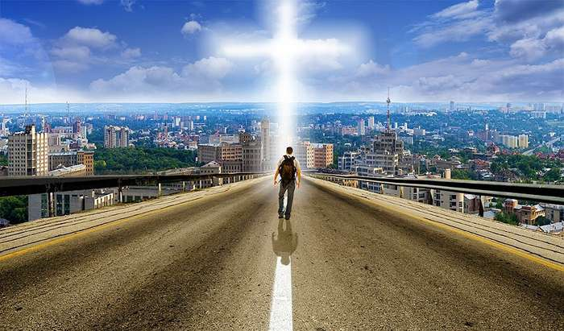

# Насанд хүрэгсдийн амьдралыг 5 үед хуваасан, хөгжилтэй тодорхойлолт

Хүний амьдрал, хүсэл мөрөөдөл, тухай тухайн наснаас шалтгаалан ерөнхийдөө бараг ижил байдаг гэнэ. Тиймээс, тухайн насны сонирхлоор нь, 5 үе шат болгон хувааж хөгжилтэйгээр илэрхийлснийг сонирхуулья. Аль үед нь байгаагаа мэдэж аваад, зайлшгүй дараалан ирэх дараагийн үеүдээ бэлтгэл төгс угтан авцгаая. Хүн ер нь, ухаарч, их сайхан болоод хорвоогоос явдаг бололтой юм. Дараагийн амьдралдаа бэлтгэдэг ч юм шиг...

Нэгдүгээр үе:

Том сайхан байшин, үнэтэй машин хүсч, царайлаг, гоолиг хосыг эрж хайж, сонирхон, үл тайлагдах нууцуудын талаар өгүүлсэн ном зохиол уншиж, уран зөгнөлт кино үзэх дуртай. Хамгийн их хувцаслалтдаа анхаарч байдаг үе бөгөөд энэ насанд өмсөх хувцасныхаа 3/2-г өмснө. Энэ үедээ, мөрөөдөн хүсч буй тухайн зүйлсдээ зарцуулагдах мөнгө төгрөгийг огт тооцож мэддэггүй. Зөвхөн тийм хэрэглээ л, мөрөөдөл хүсэл нь болж, зүтгэж байдаг. . Зөвлөгөө: Энэ үе, хамгийн их дэмжлэг хэрэгтэй байдаг, бусдаас хамааралтай, мөн орчин тойрны нөлөөллөөс цаашдын амьдрал шийдэгдэх хариуцлагатай үе юм. Тиймээс, хүрээлэлдээ гойд анхаарах хэрэгтэй байдаг.

Хоёрдугаар үе:

Жижигхэн, загварлаг, түлш бага хэрэглэдэг машин, үнэт эдлэл хэрэглэх хүсэлтэй болж, далд зүйлийг сонирхох сонирхол нь буурч, адал явдалт зохиол, кино үзэх нь ховордож, хосоо сонгохын хувьд, царай зүс биш, ухаалаг, мөн сайн хамтрагч байх талаас нь харж эхэлдэг. Зөвхөн өөртөө найдаж эхэлсэн, бусдаас тусгаар байх, бие даах эрмэлзэл дүүрэн үе тул, шагнал, мөнгө, ялалт, байлдан дагуулалтыг хүсч байдаг. Зөвлөгөө: Өөртөө итгэлтэй, өөрөөрөө байхад суралцах, шийдэмгий байх нь юунаас ч чухал.

Гуравдугаар үе:

Автобус, нийтийн тээврийн хэрэгслээр, хямд төсөр, хурдан гэдэг утгаар нь зорчихоос буцахгүй болж, роман уншиж, буян нүглийн талаар сонирхох болж, шүдээ угаахдаа усаа хаадаг, мөн “Карма”-гаа хайрлах үүднээс, тэр бүр хүн амьтныг шүүмжилэх, мөн муудалцахаа больдог ба ганц бие хүмүүсийн хувьд, яг өөрийн гэсэн хүнээ олохгүй байна гэж эрж хайсаар, хэсэг зуур дурлалд автахаа больсон байдаг. Зөвлөгөө: Урдах үеүдээс олж авсан туршлагуудаа улам бататган, шалгарсан найдвартай замаа сонгон урагшил.

Дөрөвдүгээр үе:

Байр, машин, үнэт эдлэлийг тоохоо больж, аялах, бүр гэнэ гэнэ даяанчилах ч хүсэл төрдөг болж, өөрийгөө таних, олохын тулд дотогш, дотоод ухамсартаа анхаарч, амьдралын утга учирын талаар унших сонирхолтой, бусдыг хайрлаж сурах, хайр халамжийг түгээхэд идэвхийлэн зүтгэдэг. Зөвлөгөө: Олж авсан байр сууриа батжуулж, дураараа амьдар.

Дээд буюу тавдугаар үе:

Өөрийгөө ерөнхийдөө таньсан, мэдэрсэн, олсон. Энэ талаар их яриад байхгүй. Өөртөө эд эдлэлийг тав тухтай талаас нь, сайн сонгож хэрэглэдэг болж, зав зайндаа хөнгөн, сэтгэл хөдөлгөм, дурсамж дуудсан ном зохиолууд унших дуртай, байн байн цаг хардаг зуршилтай, хүүхдүүдийнхээ ээж /аав/ буюу өөрийгөө хайрладаг болдог. Хорвоо нэгдмэл нэг учираас нэг л зүй тогтолтой, үйлийн үр учир шалтгааны хэлхээн дунд амьдрал өрнөж байдгийг, мөн хорвоо оюун санаагаар дүүрэн болохыг мэдэж, сэтгэл зүрхээ чагнахын чухлыг ухаарч, ертөнцийн дохио тэмдгүүдийг унших талаар сурахыг хичээн нирваанд хүрэхийг эрмэлзэн амьдарч байдаг. Зөвлөгөө: Энэ үеийнхэн дээрхи зөвлөгөөнүүдийг өгсөн тул, тэдэнд хандсан зөвлөгөө байхгүй.

