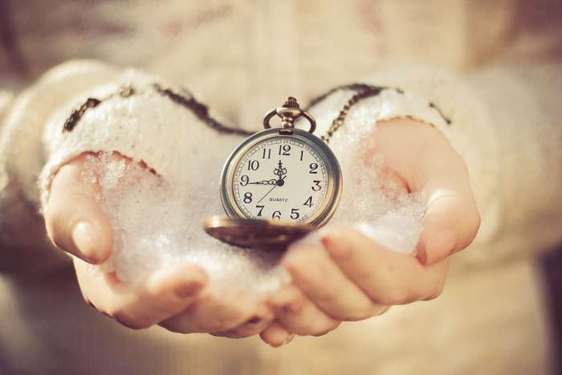

# Насыг тань уртасгах 5 минут

Энэхүү зөвлөгөө нь ямар нэг, эрүүл амьдрахын нууц юм уу, хоолны дэглэм, дасгал сургуулилалт гэсэн заавар биш ээ, харин 5 минутаас ч бага хугацаа зарцуулан эрүүлжүүлэх увидастай гэнэ шүү. Уншиж хэрэгжүүлээрэй.

1/ Шатаар өгсөх нь булчингуудыг ажиллуулах сайн гэх ч хүсэхээр зүйл биш дорхноо залхчихмаар хэцүү, гэтэл өөрийгөө хүчилж зовоохгүйгээр уруудаж буугаад байх нь илүү хялбар, мөн л адилхан ердийн алхах үед бага ажилладаг хөлийн арын булчингуудыг хөгжүүлдэг байх нь. Тун болгоомжтойгоор, хэдхэн гишгүүр арагшаа хараад, ухраад буувал бүр ч илүү үр дүнтэй. Гэхдээ харсан хүн гажиг гээд бодчихвий гэдэг талаас нь бодож, хүн хараагүй байхад тайван хийсэн нь дээр байх.

2/ Хуян тараах гэж бариулахаас эхлээд дасгал хийх гэж хүч заваа зарцуулахын оронд, харандаа юм уу үзгээ амандаа зуугаад цагаан толгойн үсгүүдийг агаарт зурах, болвол хоёр удаа хийчихвэл хангалттай үр дүн гарна. Англи хэлний цагаан толгойн үсгүүдээс манайх хэдээр илүү нь бас илүү үр дүн дагуулна шүү

3/ Далайн давс 1 хоолны халбагыг аяга усанд уусгаад өглөө бүр амаа зайлж байвал шүд, амны хөндий, хоолойн өвчилөлөөс холдно гэсэн үг

4/ Амьсгаа аваад, уушгин дах агаараа бүрэн гаргасны дараа аль болох удаан амьсгалаа түгж. 3 минут түгжиж байвал гайхалтай. Эд эсэд маань ачаалал, хязгаарлалтын аль аль нь хэрэгтэй байдаг гэж зүрхний мэс засалч, академич Амосов нотолсон байна. Амьсгал түгжилтийн дэлхийн рекорд 18 минут 3 секунд байдаг гэнэ шүү.

5/ Түүхий лууван, манжин, байцааны гол мөн хивэг, алим хар талх идэж бай. Цагаан мах эргэх гэдэг зовиурт өвчин тусахаас бүрэн зайлсхийнэ.

6/ Дөрвөн хөллөөд нуруугаа хотойлгон таазаа эргүүлэх хөдөлгөөн 2 минут орчим хий. Мууран дасгал гэж нэрлэх нь ч бий. Нурууны өвчинд нэрвэгдэхгүй

7/ Унтахын өмнө хөлөө өвдөг хүртэл хүйтэн усаар шүрш. 1 минут орчим хангалттай. Бөх нойрсоно, хөлийн венийн судсандаа анхаарал тавьлаа гэсэн үг, мөн бүтэн биеэрээ мөстэй усанд орохтой дүйцэхээр чийрэгжинэ.

8/ Толгой, хүзүү, мөр, нуруу, хуруу, хөл, гар, бүр уруулаа хүртэл мушгируулж, “Чи чинь юу хийгээд байна аа?” гэж эрхтэнүүд чинь орилохоор хамгийн эвгүй байдалд ганцхан минут тэвчиж суу. Хэр хачин мэдрэмж төрж байна төдий чинээ ажилладаггүй залхуу булчингууд чинь ажиллаж байгаа. Баярлах хэрэгтэй биз дээ?

9/ Хананд наалдаж зогсоод хоёр мөрөө шүргүүлэн зогсно. Толгой дээрээ ном тавиад, хананаас хөндийрч 10 удаа сууж бос. Толгой дээрээс чинь “мэдлэгийн эх булаг” тань унахгүй байх ёстой. Алхаа тань төгс болно

10/ Зөвхөн амны тусламжтай хоол иддэг гэж бид боддог, гэтэл бидний арьс түм буман шүдгүй, ховдог ам шиг, юу ч хамаагүй сороод идчихдэг чадвартай аж. Тиймээс усанд орохын өмнө нүүр хүзүү, мөрөндөө ч атугай зөгийн бал түрхэж 3-4 минут байлгаад угаалаа үйлдвэл, ходоодоор дамжих урт замыг туулж түүнд багахан хэсэг нь хүрдэг 40 гаруй амин дэм, микро элементүүдийг шууд хүртээж арьсаа баярлуул.

11/ Нянгүйжүүлэлт хийе гэвэл, нэг аяга усанд нэг лимоны шүүсийг шахаад уу. Дархлаа тань ч өснө. Харин эрэгтэй хүн аав болох төлөвлөгөөтэй байгаа бол хэрэггүй. Идэвхитэй спермийн тоог бууруулна.

12/ Шүршүүрт орох үедээ халуун усаар /тэсэшгүй биш шүү/ хамгийн өндөр даралтаар 10 см-н зайнаас нүүрээ улайтал эрэлхэгээр шүрш. Дулааны үйлчилэлд нүүрний булчин цочирч, цусны эргэлт нь сайжирснаар арьсны өнгө, уян хатан чанар сэргэнэ

13/ Хааяа, хэрэв архи дарс хэрэглэдэг бол хоёр долоо хоногт нэг удаа, “Хар нүүрс”-н эм 6-7 ширхэгийг нэг дор усанд найруулан хэрэглэж байвал биед хуралдсан хүнд металлууд, ургамлын гаралтай хорыг гадагшлуулна. Байнга хэрэглэж болдоггүй. Учир нь бие дэх ашигтай зүйлсийг ч шингээгээд гаргачихдаг гэнэ

