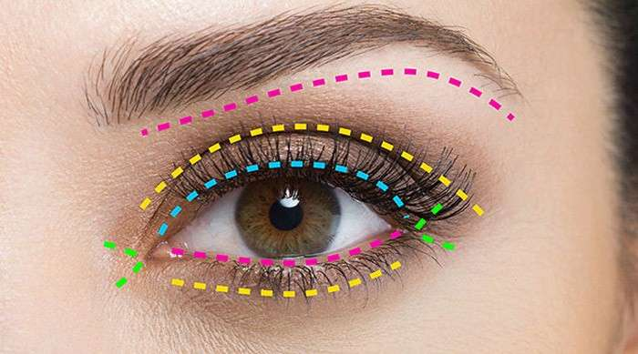
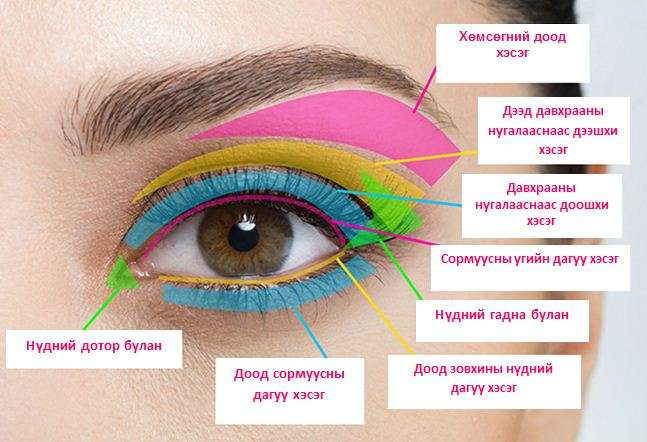
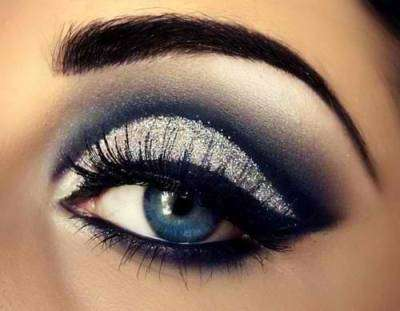

# Нүдийг зөв сайхан будах зөвлөгөө

-Хөмсөгний доод хэсэгт, гялгар боронзтой эсвэл цайвар өнгийн тен тавих /сүүн, зааны ясан, мөнгөлөг/\
-Давхрааны нугалааснаас доошхи хэсэг. Түрхэх теньний үндсэн өнгө эсвэл харандаагаар зурж өгнө\
-Давхрааны нугалааснаас дээшхи хэсэгт, үндсэн теньний өнгөнөөс 2 дахин бараан өнгийн тень түрхэх буюу зурна. Хэрэв дээд зовхи унжсан бол, давхрааны нугалаас нилээдгүй гүн байдаг тул нүд нээлттэй байхад ил гарч байхаар дээш нь илүү гаргаж зурах, тениэ тавих\
-Нүдний гадна булан. 1 эсвэл 2 өнгөөр бараан байх харандаа, тениэр зурах\
-Дээд сормуусны угийн дагуух хэсэг. Контур, нарийн үзүүрлэсэн харандаагаар нарийн зурна\
-Доод зовхины сормуусны дээрхи нүдний дагуухи хэсэг. Нүдээ том харагдуулъя гэсэн тохиолдолд цайвар өнгөөр, тодруулах бол хараар буддаг\
-Доод зовхины сормуусны угийн дагуу доод хэсэг. Цайвар, мат өнгийн тень тавих нь нүдийг том, харцыг сайхан болгодог\
-Нүдний дотор булан. Цайвар гялалздаг тенийг хөнгөхөн, анзаарагдамгүй түрхдэг

---

Нүдээ зөв сайхан будаж, баяртайгаар харцаа шидлэн өөртөө итгэлтэй цоглог алхаарай, бүсгүйчүүд ээ!
