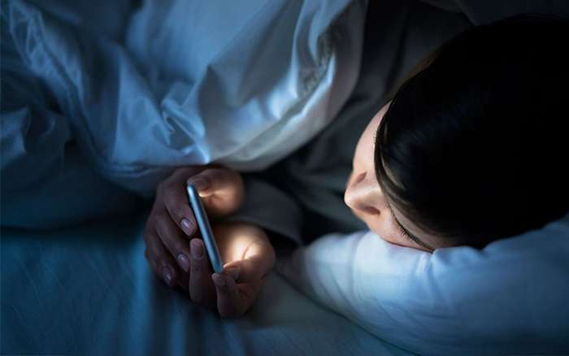
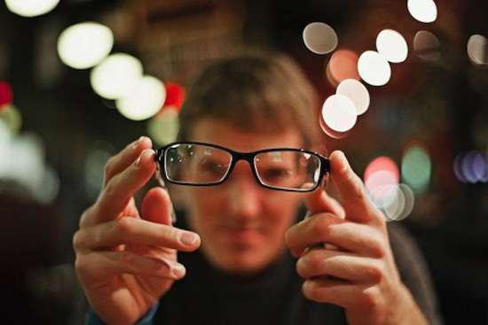

# Нүдний эмч нарын анхааруулга!

Эмч нар, сүүлийн үед, түр зуур юм харахаа байх, хараагаа алдах, сохрох байдал давтагддаг хүмүүс олноор хандах болсноор, эдгээр хүмүүс дээр, оношийг тогтоох төрөл бүрийн байж болох бүх судалгааг явуулсны эцэст, тухайн хүмүүсийн хувийн амьдралын хэвшилийг судалж, шалтгааныг нь олжээ.

Эмч нар, эдгээр хүмүүс унтахын өмнө гар утсаа байнга, удаанаар ашигладаг нийтлэг зуршилтай болохыг олж мэдсэн байна. Хэвтээ байдалд, утсаа ашиглах үед, хүний нүд, гар утасны гэрэлд дасаж, мөн зэрэг харанхуйг харж байдгаас, тархины, өдөр, шөнийг зэрэг хүлээж авах боломжгүй байгалийн тогтолцоо алдагдаж төөрөлддөг. Тиймээс хараанд маш муу нөлөөлдөг болохыг тогтоожээ. Гар утаснаас ялгарах цэнхэр гэрэл, бидний төсөөллөөс давсан хор хөнөөлтэй гэдгийг сүүлийн 20-д жилийн хугацаанд хүмүүсийн харааны өөрчлөлт, нүдний хүнд өвчлөлүүд ихэссэнтэй холбон үзжээ. Нүдний эмч нар, харанхуйд ашигласан гар утасны гэрлээс болж, эрт хараа муудах байдал ихэссэн, тэдний харааны байдал 75 настай хүний хараатай ижил хэмжээнд хүрсэн байдаг, мөн зөвхөн хараанд нөлөөлөөд зогсохгүй, бие организмыг өвчлөлд хүргэх гол шалтгааны хэмжээнд авч үзэх хэрэгтэй болсныг дурдаад, энэ асуудлыг түгшүүрийн харангын хэмжээнд хүлээн авч, энэ зуршлаас салахыг, ийм зуршилд автахгүй байхыг онцлон анхааруулжээ.
